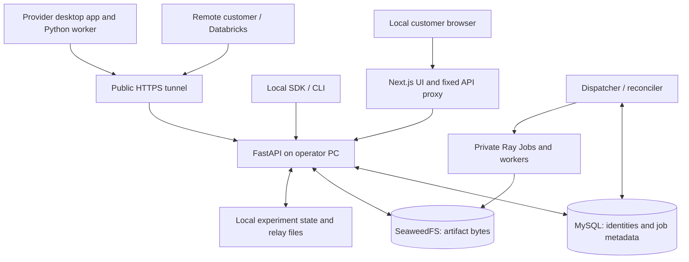

# GreenTokens: developer guide

> Publication note: machine names, private addresses and deployment URLs are placeholders. Recorded probe outcomes refer to the original private deployment, not to the example hostname. This documentation branch does not deploy the plan or publish the local experiment runtime.


GreenTokens lets a customer submit an **approved computing workload**, lets available computers execute it, and returns status, logs, metrics, and model files. The operator runs the services coordinating those computers. Providers lend computing capacity; customers submit work.

This is the authoritative overview of the **current checkout**, reviewed against source on **19 November 2026**. It describes a development/pilot system, not a production cloud. Source paths show implementation; measured reports show observed results; plans describe work that has not happened yet. Explanations of technology choices describe their engineering fit, not an undocumented historical decision.

**Hosting-plan update, 20 November 2026:** the target operator server is the stationary Raspberry Pi `operator-server`. the development PC remains the current hosting arrangement until the Pi passes readiness and migration checks, then becomes a development/administration computer. This is a plan update, not a claim that cutover or permanent public hosting has happened.

## Reading map

- [Capabilities and limits](#capabilities-and-limits)
- [System architecture](#system-architecture)
- [Target hosting structure: Raspberry Pi server](#target-hosting-structure-raspberry-pi-server)
- [Technology choices explained](#technology-choices-explained)
- [Repository and component map](#repository-and-component-map)
- [Follow a job through the system](#follow-a-job-through-the-system)
- [Networking and hardcoded addresses](#networking-and-hardcoded-addresses)
- [Data, identities, and trust](#data-identities-and-trust)
- [Run the project](#run-the-project)
- [Validation and troubleshooting](#validation-and-troubleshooting)
- [Changing the project](#changing-the-project)
- [Source, GitHub, and installed apps](#source-github-and-installed-apps)
- [Terminology](#terminology)

## Capabilities and limits

| Capability | Current implementation and limits |
| --- | --- |
| Customer web UI | Root Next.js app with mock mode and local live API mode; not a public customer login portal. |
| Local Python SDK/CLI | Standard-library client using local development identities; CLI examples cover sum and linear regression. Not published to PyPI. |
| Ray jobs | `sum_numbers_v1`, `linear_regression_v1`, and development `bert_tiny_ddp_v1`. |
| Remote provider accounts | Signup/login/logout, salted password hashes, device-bound 24-hour sessions. No password recovery or persistent keychain login. |
| Independent providers | Desktop agents poll HTTPS, run approved packages, renew leases and upload results. They do not need a Ray cluster. |
| Single-provider training | `text_finetune_v1`: approved BERT models on SST-2, CPU or usable NVIDIA GPU. Separate jobs can run concurrently on separate providers. |
| Four-PC shared model | Local experiment with HTTPS relay and periodic model-change averaging; a saved run reports success. Not a general distributed training product. |
| Databricks | Customer notebooks and HTTPS bearer adapter exist; real workspace egress, secrets and Catalog permissions require workspace-specific validation. |
| Durability | MySQL job records, SeaweedFS artifacts, plus local experiment files. Automated backup/restore is not implemented. |
| Permanent address / unattended hosting | Planned on the Raspberry Pi. Stable public HTTPS for providers, private Tailscale administration, boot/restart supervision and backups. Current the development PC launcher still uses a temporary tunnel and background processes. |
| Arbitrary code, billing, hostile-provider isolation | Not implemented. Approved code and trusted participants are pilot assumptions. |
| TrOCR | UI/contract work only; not an accepted backend template. |
| OpenViking shared agent knowledge | Future task only, recorded in [project memory and roadmap](docs/roadmap.md). Not installed or integrated. |

The generic requirements schema still uses `gpus: 0` and `execution_class: trusted_cpu`. Provider GPU selection instead uses `parameters.require_gpu` and usable CUDA capability. This is not a complete GPU allocation scheduler.

## System architecture

The **control plane** handles identity, job records, assignment and cancellation. The **execution plane** runs calculations. Metadata and artifact bytes use different storage services.

The diagram below describes the existing implementation's service relationships. The next section specifies the target host placement and operational changes; these must not be mistaken for already deployed features.



There are **two execution paths**:

1. **Ray:** the dispatcher submits a fixed driver to Ray Jobs. Ray schedules tasks/actors in a trusted cluster. The default launcher creates a local cluster; older group tools can attach multiple trusted machines.
2. **Independent providers:** remote desktop agents ask the API for jobs. The API claims rows transactionally and returns package metadata. Python workers execute packages locally. The dispatcher checks expired leases but does not submit these jobs to Ray.

Several connected computers do not automatically train one model together. Ordinary provider jobs each use one computer. The four-PC experiment explicitly coordinates replicas of one model.

## Target hosting structure: Raspberry Pi server

### Machine roles

## BERT-Tiny CPU training starter

The first model-training baseline lives in [`examples/bert_tiny_cpu/`](examples/bert_tiny_cpu/README.md). It fine-tunes `prajjwal1/bert-tiny` on 999 SST-2 examples using CPU only, saves and reloads a checkpoint, runs sentiment prediction, and records timing and validation metrics. [中文操作说明](examples/bert_tiny_cpu/README_zh.md) cover Apple Silicon Macs (including M4) and Windows.

The actual pretrained model files are included under [`assets/model/`](examples/bert_tiny_cpu/assets/model/). A pinned, checksum-verified downloader prepares SST-2 locally; its unknown license metadata is documented and raw data is not republished. See [asset provenance and setup](examples/bert_tiny_cpu/assets/README.md).

This is a standalone single-computer experiment with its own optional environment. It is not yet a customer API template or a Ray Train job. The next training experiment targets three distinct computers; the existing four-machine platform milestone remains separate. Training execution and multi-computer results have not been verified. The existing `sum_numbers_v1` pipeline remains the customer MVP.

## Team ownership

| Area | Owner | Deliverables | Primary files |
| --- | --- | --- | --- |
| **Person A - project lead, shell, proxy, and submission** | **chaewon-research** | Customer app setup, navigation, fixed same-origin proxy, typed API adapters, development identity selector, inline job submission, browser-local recent job IDs | `apps/customer_dashboard/` app shell, API proxy, client/types, submission and identity modules |
| **Person B - job lifecycle and outputs** | **Michelle Lyu ([@Mrl-slll](https://github.com/Mrl-slll))** | Job detail and ~2-second polling, status/error presentation, results, authorized logs and artifacts, raw JSON file upload, cancellation | `apps/customer_dashboard/` job detail, results, file upload and cancellation modules |
| **Core backend** | **Core developer** | Backend source and local stack, API policy, job execution, storage, worker/agent implementation | `core/`, `scripts/`, `infrastructure/`, backend docs |
| **Integration and quality** | **Persons A + B** | Agree on adapter interfaces, wire pages to the API, test identity isolation and end-to-end execution, review and document the demo | Joint integration and review |

**Integration contract:** Person A leads the frontend architecture and owns the shared typed client, proxy, routes and development identity state. Person B uses that client for job detail, results, artifacts and cancellation rather than building a second transport layer. Coordinate component props, function signatures, error handling and branch integration to avoid conflicting implementations. Backend execution and deployment changes remain with the core developer.

This is **one server with automatic recovery**, not redundant high availability. Pi failure, external-drive loss, power outage or ISP failure can still stop service. A second tunnel connector does not replicate the database or stored models.

### Storage, migration and installer boundaries

- Explicitly place persistent database, object and experiment data on the external disk. Having a 1 TB drive attached does not mean Docker volumes use it. Require the mount before starting data services so a missing drive does not create an empty database on the boot disk.
- Back up to a separate device/location and test restoration. A second folder on the same external disk is not protection against disk failure.
- Inventory and preserve data on both the development PC and the existing Pi deployment. Drain/cancel active jobs before a consistent migration; retain accounts, device ownership, job records and matching artifact bytes. Do not run two independent writable copies as if they were synchronized.
- Existing installers contain a fixed public origin. They need one replacement targeting the final hostname and matching Tauri CSP. Ordinary later restarts or host moves behind that same hostname should not require another URL-related reinstall. Feature/security updates remain separate.
- Retain the development PC's hosting arrangement until the Pi is validated and cutover is deliberate. Once the Pi accepts new writes, rollback must preserve those writes rather than restoring stale the development PC data.

### Readiness evidence and outstanding work

Checks made on **19 November 2026**, not a live status assertion:

| Check | Observation | What it establishes |
| --- | --- | --- |
| **P0** | Local customer dashboard + inline job | A real `sum_numbers_v1` submission returns `10` through the frontend |
| **P1** | Complete customer MVP | JSON upload, recent jobs, results/artifacts, cancellation, usage, and identity isolation work |
| **P1** | Quality and documentation | Tested error cases, accessible layouts, reproducible setup, screenshots, and demo walkthrough |
| **P2** | Provider interface prototype | Clearly simulated onboarding, hardware, preferences, and pause states |

## Task checklist

### P0 — Repository and setup

- [x] **Core:** Add the backend source, `AGENTS.md`, `docs/applications-handoff.md` and local setup documentation to the shared repository. Exclude credentials, `.env`, `.venv`, storage volumes and private datasets.
- [x] **Core:** Document the backend API contract and command for starting the local stack.
- [ ] **A + B:** Confirm the Next.js, React, TypeScript and styling choices; review newly installed dependencies and the reported npm audit findings under `AGENTS.md`.
- [x] **A:** Initialize `apps/customer_dashboard/` with Next.js 16.4.6, TypeScript, ESLint, Tailwind CSS and the App Router. Local lint, production build and development-server startup passed on 14 November 2026.
- [x] **A:** Commit and push the frontend source and package lockfile on `feat/customer-dashboard-ui` (`8cc069c`). Open draft pull request [#1](https://github.com/Mrl-slll/greentokens/pull/1) against `main`. The following six commits are pushed: `8cc069c` (foundation), `b0b64cb` (proxy origin), `947c20b` (admin restriction), `0c7dfeb` (shared session layout), `ee50ca2` (job navigation) and `1681784` (identity persistence). Integration checks remain pending.
- [ ] **A + B:** Agree on adapter methods, component props, error behavior and separate feature branches before simultaneous work.
- [ ] **A + Core:** Prepare an approved local backend environment and verify `GET /health`. On Person A's Windows machine, the health request failed to connect, `.venv\Scripts\python.exe` was absent, and the `docker` command was not found on 14 November 2026. The core developer's `127.0.0.1` cannot be reached from another PC without separate configuration.
- [ ] **A:** Document verified frontend installation, start, mock/live configuration and API proxy steps after they are reproducible.

### P0 — Person A: application shell, proxy and job submission

**Frontend status (14 November 2026):** The customer dashboard renders locally, and ESLint, TypeScript and production-build checks passed after the latest changes. Six frontend commits through `1681784` are pushed to `feat/customer-dashboard-ui` in [draft PR #1](https://github.com/Mrl-slll/greentokens/pull/1). The shared session provider is mounted in the root layout. A `/jobs/[jobId]` route renders a clearly labeled integration placeholder; successful and browser-local recent job IDs link to it. Browser checks demonstrated form input rejection, identity selection, an admin-disabled submission control and a backend-unavailable response. The new session code stores the selected development identity locally; screenshot checks show Alice, Bob and Admin selections, but complete reload/navigation, stale-request and cross-identity access tests remain outstanding. The proxy blocked `/v1/workers` (HTTP 404), rejected a cross-origin POST (HTTP 403), and returned HTTP 502 for a same-origin request with FastAPI offline. No live job execution, completed result or authoritative detail-page data has been verified. A Next.js instant-navigation development insight was observed despite passing builds.

- [x] Build the initial customer dashboard with a visible **New job** form. The local page renders.
- [x] Move the development session provider into the shared root layout (`0c7dfeb`), create `/jobs/[jobId]` navigation (`ee50ca2`), and implement browser-local identity restoration (`1681784`). The job route is a placeholder; usage/settings navigation and complete identity-transition testing remain open.
- [x] Display **Recent jobs on this browser**, including an empty state, using browser-local IDs rather than a nonexistent server-side job-list API.
- [ ] Verify recent-job display and loading/error behavior when IDs exist and job detail is integrated.
- [x] Define TypeScript types for submissions, job detail, attempts, statuses, artifacts, results and usage from the backend implementation.
- [x] Implement a typed live API client for job submission, detail, results, artifacts, cancellation and usage.
- [ ] Add a separate mock adapter behind the agreed client interface. Never present mock data as live execution.
- [x] Implement the fixed same-origin server proxy (`/api/core/[...path]`) to `http://127.0.0.1:8000`: allowlist methods and endpoints, validate IDs, bound request sizes and preserve upstream status/content type. Confirm blocked-route rejection (404), cross-origin rejection (403), and same-origin forwarding through the proxy. Live backend connectivity is pending.
- [x] Implement a **Local development - identity stub** banner and selector (`alice`, `bob`; `admin` for diagnostics only), with `X-Dev-User` forwarding and no `organization_id` in job bodies. Confirm visual identity switching and disable customer submissions under `admin`; committed in `947c20b`.
- [x] Implement request abortion and submission-state reset on identity change, with separately keyed browser-local recent job IDs.
- [ ] Verify request teardown during identity switches, saved identity across a hard reload and client-side navigation, and cross-identity API isolation against the live backend. Identity switching and saved selections were visually inspected, but full automated and live-backend checks are pending.
- [x] Implement the inline **New job** form for `sum_numbers_v1` with 1-1,000 integer inputs, each from -1,000,000,000 to 1,000,000,000. Browser checks confirmed that empty input and decimal values are rejected.
- [x] Configure CPU-only submission defaults: 1 CPU core, `ram_gb: 0.125`, 0 GPUs, `trusted_cpu`, and `max_runtime_seconds: 60`.
- [x] Implement the `POST /v1/jobs` client method and reuse the same `idempotency_key` and request body for an uncertain retry. Live submission behavior remains unverified.
- [ ] Retain and display the backend's real `job_id` and status from HTTP 202; never invent submission success.
- [x] Implement bounded browser-local recent job ID storage, scoped by development identity.
- [x] Add links from successful submissions and browser-local recent job IDs to `/jobs/[jobId]` (`ee50ca2`).
- [ ] Integrate the job-detail component and refetch authoritative records after reload; currently this route displays an integration placeholder, not API data.
- [x] Verify visible form errors for empty and decimal input, plus an offline `Local API unavailable` state for a valid submission.
- [ ] Complete accessibility checks, replace the job-detail placeholder with Person B's implementation, and verify navigation using a real returned job ID.

### P0 — Person B: job detail, polling and results

The checked items in this section reflect the existing team checklist. Person B's implementation has not yet been integrated into Person A's branch; do not interpret these checkmarks as verified functionality in the current customer dashboard.

- [x] Implement **Job detail** with authoritative `GET /v1/jobs/{id}` data: job ID, status, attempts, timestamps, error code, artifacts and cancellation state.
- [x] Poll active jobs approximately every 2 seconds. Stop on terminal status, navigation or identity change; abort stale requests and back off on transport errors.
- [x] Render `QUEUED`, `DISPATCHING`, `RUNNING`, `SUCCEEDED`, `FAILED` and `CANCELLED` using actual API states, without fabricated progress or timestamps.
- [x] Show actionable states for validation/resource rejection (422), result not ready or idempotency conflict (409, depending on operation), queue limit (429), expired result (410), artifact failure (502), inaccessible job (404) and offline transport errors.
- [x] Fetch `GET /v1/jobs/{id}/result` after success, display the real output and keep successful jobs marked `SUCCEEDED` when an output expires.
- [x] Implement authorized artifact/output retrieval and plain-text log rendering through Person A's client and proxy.
- [x] Display cancellation-pending and status transitions accurately. Person A supplies the shared API methods; Person B owns this screen's request lifecycle.
- [x] Support keyboard, focus, text status labels, responsive layout, and loading/empty/error states on job-detail and results screens.

### P0 — First integration (Frontend A + B)

- [ ] Bring Person B's job-detail source into the shared repository or otherwise make it available for review; confirm the `/jobs/[jobId]` integration interface and shared client usage.
- [ ] Replace the route placeholder with real detail, polling and result components; keep identity changes from exposing stale results.

- [ ] Connect the New Job form to the live submission adapter and display the backend's returned job ID.
- [ ] Connect the detail view to actual job states: `QUEUED`, `DISPATCHING`, `RUNNING`, `SUCCEEDED`, `FAILED`, `CANCELLED`.
- [ ] Submit `[1, 2, 3, 4]` through the frontend, wait for `SUCCEEDED`, and display the actual result `10`.
- [ ] Refresh the job page and verify that the known job loads again from the API.
- [ ] Switch from `alice` to `bob` and verify that Alice's visible job and result data are cleared.
- [ ] Record the setup commands and a screenshot or short walkthrough of the live flow.

### P1 — Uploads, artifacts, cancellation and usage

**Person A**

- [x] Define typed live client methods for file upload, artifacts, cancellation and usage through the allowlisted proxy. Runtime integration with Person B remains pending.
- [ ] Keep development identity scoping and known-job recovery correct for jobs created from uploaded artifacts.
- [ ] Add a **Settings** view for development identity and mock/live selection; no real account profile or billing settings.
- [ ] Add a **Usage** view showing actual `attempts`, `wall_seconds`, `billable: false` and `measurement` from `GET /v1/usage`, without invented GPU metrics or pricing.

**Person B**

- [ ] Add a JSON-file input option (maximum 65,536 bytes), validating `values` against the same bounds as inline submission.
- [ ] Send raw JSON to `POST /v1/artifacts` (not multipart form data), then submit the returned `input_artifact_id` without inline `parameters`.
- [ ] Never blindly retry an ambiguous artifact upload: the upload endpoint has no idempotency contract.
- [ ] Download authorized input/output JSON and plain-text logs using `GET /v1/artifacts/{id}` through the shared proxy; show actual hash, size and expiry, use safe filenames and release temporary object URLs.
- [ ] Implement `POST /v1/jobs/{id}/cancel`; show **Cancellation requested** and continue polling until the backend confirms its actual outcome.
- [ ] Handle result expiry independently of job status: an expired artifact does not turn `SUCCEEDED` into `FAILED`.

**Joint acceptance**

- [ ] Submit uploaded `{"values":[1,2,3,4]}` through the real backend and retrieve result `10`.
- [ ] Verify Bob cannot fetch Alice's job/result/artifact IDs (expected `404`) and identity switching clears previously displayed data.
- [ ] Verify cancellation stays pending until the backend confirms the final state.

### P1 — Tests and release checks (Frontend A + B)

- [ ] Test empty input, non-integers, out-of-range values, overlong arrays, invalid JSON, and oversized files.
- [ ] Test submission outcomes: validation/resource rejection (`422`), idempotency conflict (`409`), and queue limit (`429`).
- [ ] Test result/artifact states: result not ready (`409`), expiry (`410`), artifact failure (`502`), and inaccessible IDs (`404`).
- [ ] Test offline mode, request timeouts, stalled polling, cancellation, and rapid navigation/identity changes.
- [ ] Verify that pending requests do not update the UI after switching users or leaving a job page.
- [ ] Verify that replaying the same submission key and body returns the same job ID after an uncertain response.
- [ ] Verify that logs are rendered as text and no frontend bundle or network request exposes infrastructure credentials.
- [ ] Check keyboard navigation, contrast, focus states, error messages, and responsive layout.
- [ ] Run the approved frontend unit/integration/end-to-end checks; record actual results and known failures.
- [ ] Review the final live flow together and include reproducible commands, screenshots, and outstanding limitations in the handoff.

### P2 — Provider interface prototype (owner to be assigned; review with Core)

Start this only after the customer MVP is accepted.

- [ ] Design provider welcome and consent screens, including resource/privacy implications and unchecked consent.
- [ ] Design simulated invitation/approval steps; do not imply that real provider accounts are available.
- [ ] Design a hardware panel separating CPU, system RAM, GPU, VRAM, and free disk; label all mock values.
- [ ] Design availability and resource-limit preferences with a simulated readiness check.
- [ ] Design the provider home screen with a paused-by-default state, pause control, and offline/missing-agent states.
- [ ] Label earnings **Unavailable during pilot**. A mock pause must not claim to stop real jobs.
- [ ] Review pause semantics and future worker-agent API requirements with Core before any live integration.

## Backend endpoints used by the customer app

| Method | Endpoint | Use |
| --- | --- | --- |
| `app/`, `components/`, `lib/` | Customer UI, API proxy, mock/live clients and inference demo | [Web app](app/README.md) |
| `core/api/`, `core/config.py` | API, request policy, authentication | [Backend](core/README.md) |
| `core/database/` | Tables, database sessions and migrations | [Database](core/database/README.md) |
| `core/artifacts/` | Object-storage writes, expiry and integrity | [Storage](core/artifacts/README.md) |
| `core/jobs/`, `core/ray_runtime/` | Scheduling, leases and Ray drivers | [Execution](core/jobs/README.md) |
| `core/workloads/` | Approved calculation/training code | [Workloads](core/workloads/README.md) |
| `apps/provider_app/` | Desktop UI, native bridge, Python worker | [Provider app](apps/provider_app/README.md) |
| `apps/provider_site/` | Static installer download page | [Download site](apps/provider_site/README.md) |
| `sdk/` | Local Python API client and CLI | [SDK](sdk/README.md) |
| `databricks/` | Remote customer notebooks and client adapter | [Databricks](databricks/README.md) |
| `scripts/`, `infrastructure/` | Startup, diagnostics, container definitions and older group tools | [Operations](scripts/README.md), [infrastructure](infrastructure/README.md) |
| `examples/` | Small pipeline examples and standalone BERT baseline | [Examples](examples/README.md) |
| `experiments/` | Research workflows and measured reports | [Experiments](experiments/README.md) |
| `tests/` | Python tests; UI tests also live beside frontend code | [Testing](tests/README.md) |
| `.github/workflows/` | Installer and site automation | [Delivery](.github/README.md) |
| `docs/` | Runbooks, contracts, roadmap and historical evidence | [Documentation index](docs/README.md) |
| `greentokens/` | Ignored separate checkout on this workstation | Not a package/submodule of the outer repository. Check which checkout your editor/server uses. |
| `.tools/`, `.venv/`, `node_modules/`, `.next/` | Local tools, dependencies and generated output | Not portable application source. |

## Follow a job through the system

### Local linear regression

1. The SDK reads JSON data and TOML configuration, then submits a job with a stable idempotency key and local identity selector.
2. FastAPI validates inputs, quotas and worker availability, then stores a `QUEUED` job in MySQL.
3. The dispatcher records an attempt before contacting Ray. This is a **database-backed durable work queue**, not a separate message broker.
4. Ray Jobs runs `core.ray_runtime.runner`, which loads persisted approved input and executes the calculation.
5. Output bytes go to SeaweedFS; their key, checksum, size and expiry go to MySQL.
6. The reconciler checks execution status. The customer retrieves status/results through organization-scoped routes.

The Ray lifecycle is `QUEUED → DISPATCHING → RUNNING → SUCCEEDED / FAILED / CANCELLED`. Fast jobs may finish between polls.

### Remote provider training

1. A provider signs in. Its session is bound to its device ID.
2. The native app starts the worker with credentials in its environment. The worker reports capabilities and long-polls `/v1/provider/work`.
3. A customer submits `text_finetune_v1`. Assignment claims a queued job under a transaction. One provider runs that job.
4. The worker downloads/checksums the approved package, executes it and renews a 90-second lease.
5. It uploads artifacts and reports completion. The API checks ownership and requires an output artifact record for success.
6. Expired leases can cause requeueing up to three total attempts. Retrying is not checkpoint resume or guaranteed exactly-once execution.

The provider loop already retries transient failures with backoff from 2 to 60 seconds while enabled. Authentication failures and a closed app are different conditions. A long outage can interrupt a job even if the worker later reconnects.

### Four providers, one model

The operator-only shared-test route creates four device-pinned jobs. Providers train locally, periodically exchange compressed weight changes through HTTPS chunks, and verify identical resulting weights at barriers. Remote rank zero averages changes. the development PC relays and coordinates; it does not train this model.

See [the experiment](experiments/four_pc_cpu/README.md). Its final measured method is periodic local training plus weight-change averaging, not the earlier proposed per-step-gradient method and not Ray DDP.

## Networking and hardcoded addresses

`127.0.0.1` means **the machine running the caller**. On the development PC it means the development PC; on a provider computer it means 333.

| Setting | Purpose |
| --- | --- |
| `127.0.0.1:3000` | Local customer Next.js app |
| `127.0.0.1:8000` | Operator's FastAPI, used by local clients and tunnel connector |
| `127.0.0.1:1420` | Provider Vite preview; not the provider API |
| `127.0.0.1:8265` | Private Ray Jobs/dashboard |
| `127.0.0.1:3307` | Dedicated MySQL container's host port |
| `127.0.0.1:8333` | SeaweedFS S3 API |
| `provider-server.json` | Public API origin compiled into provider JavaScript by Vite |
| Tauri `connect-src` | Allowed webview connection origins; must match the public origin |
| CI `GT_PROVIDER_SERVER` | Optional build-time override of the provider origin |

Remote path: **provider → public HTTPS → cloudflared on the development PC → `127.0.0.1:8000` on the development PC**. Backend loopback is intentional; a remote provider must use the public address.

The current startup script creates a **Quick Tunnel** whose hostname can change. Editing configuration does not update installed apps. Rebuilding does not update an old release asset unless the new installer is published. Re-downloading the same asset gives the same embedded address.

Permanent DNS, a persistent tunnel and supervised startup are [planned](docs/roadmap.md), not installed by these docs. Stable addressing does not keep a powered-off server available.

The updated deployment proposal uses `operator-server`, a user-reported Raspberry Pi with 8 GB RAM, 1 TB external storage and Debian, keeping the development PC for development. Its existing HTTPS backend responds, but provider login currently returns 404 and remote development selectors are accepted. Read the [specific deployment plan and verification findings](docs/server-migration-plan.md). The user wants private Tailscale administration plus public provider access; readiness, migration and automatic recovery are not yet established.

## Data, identities, and trust

- MySQL stores organizations, users, password/session hashes, workers, jobs, attempts, artifact metadata and nonbillable usage.
- SeaweedFS stores normal artifact bytes. Default expiry is 24 hours; expiry blocks reads but does not delete stored bytes. Normal size limit is 64 KiB; model-kind storage allows up to 512 MiB. A proxy may impose a smaller transfer limit.
- Experiment relay/run files are separate local data and require separate backup consideration.
- `X-Dev-User: alice/bob/admin` selects a development identity; it is not secure authentication.
- Provider password sessions are real, device-bound bearer credentials for the provider role. They do not create customer/admin access.
- Customer/operator bearer API keys use a separate mapping to existing users.

`GT_MODE=development` remains required. Proxy-header detection blocks tunneled requests from using development selectors, even though the tunnel itself reaches loopback. Changing proxy topology requires reviewing that boundary. Worker trust flags and reported hardware are not attestation; approved workloads are not a hostile-code sandbox. See [security boundaries](docs/security-boundaries.md).

## Run the project

Commands are for the **outer repository root**, in PowerShell. Avoid starting a second stack on occupied ports. Existing server orchestration is Windows-oriented; client portability does not prove server portability.

These are the current the development PC/local-development commands, not the Pi's unattended deployment instructions. The [target hosting structure](#target-hosting-structure-raspberry-pi-server) is planned separately; do not assume running this launcher on Debian completes migration or service supervision.

### Initial environment

Use Python 3.12, Docker Desktop and Node 24. For a fresh checkout:

```powershell
python -m venv .venv
.\.venv\Scripts\python.exe -m pip install -r requirements-core.txt
npm.cmd ci
```

Do not recreate a working environment routinely. If this workspace's portable Node is needed:

```powershell
$nodeDir = (Get-ChildItem .tools -Directory -Filter 'node-*-win-x64' | Select-Object -First 1).FullName
$env:PATH = "$nodeDir;$env:PATH"
```

### Start backend and web app

With Docker Desktop ready, leave this running:

```powershell
.\.venv\Scripts\python.exe -m scripts.local_stack
```

In a second terminal:

```powershell
npm.cmd run dev
```

Open `http://127.0.0.1:3000`; select **Settings → Live** for real jobs. Check `http://127.0.0.1:8000/health` separately. That route checks API/database access, not all workers, storage operations or public connectivity.

### First real job

Use an unused directory name; `init` refuses overwrites:

```powershell
$env:PYTHONPATH = "$PWD\sdk"
.\.venv\Scripts\python.exe -m greentokens check
.\.venv\Scripts\python.exe -m greentokens init onboarding-training
.\.venv\Scripts\python.exe -m greentokens explain onboarding-training/training.toml
.\.venv\Scripts\python.exe -m greentokens submit onboarding-training/training.toml
```

Use the returned ID with `status`, `wait`, `logs` and `result`. Retry uncertain submissions with the same idempotency key and input. Change the key for a new job. See [SDK](sdk/README.md).

The proxy allows documented customer API routes under `/api/core/` and forwards them to `http://127.0.0.1:8000` on the same machine. The blocked `/api/core/v1/workers` route returned HTTP 404; a cross-origin POST returned HTTP 403; and a same-origin POST reached the backend connection attempt and returned HTTP 502 while FastAPI was offline. The dashboard displayed `Local API unavailable` for a valid submission, with a retry option that preserves the request key. The admin identity cannot submit jobs through the customer form. The new `/jobs/[jobId]` page displays an unverified-identifier placeholder until detail integration. No live job or result has been verified. For a fresh checkout, run `npm.cmd ci` in `apps/customer_dashboard/` before the commands above. Do not copy virtual environments or credentials between machines.

### Person A backend setup status (14 November 2026)

The frontend can run without the backend, but live submission and artifact retrieval require FastAPI and its supporting local services. The following observations are from Person A's Windows PowerShell environment, not from the core developer's machine:

| Check | Observed result |
| --- | --- |
| `curl.exe -i http://127.0.0.1:8000/health` | Connection failed: no service reachable on port 8000 |
| `Test-Path .\.venv\Scripts\python.exe` | `False`: documented virtual environment not present |
| `docker --version` and `docker info` | `docker` command not recognized; Docker CLI not accessible from this shell |

Before attempting the launcher, confirm a supported Python 3.12 environment and a working local Docker Desktop installation, following `docs/local-development.md` and the core developer's setup guidance. The documented command above is **not currently runnable on Person A's machine**. Installing tools is a separate local setup step; do not copy another developer's `.venv`, containers, service credentials or persistent volumes. Keep all services bound to loopback and do not expose the development identity stub publicly.

### Immediate integration priorities

1. Coordinate the job-detail component handoff with Person B and integrate it at `/jobs/[jobId]` through the shared client.
2. Prepare and validate Person A's approved backend environment with the core developer; only mark `/health` verified when it responds successfully.
3. Prove a real inline `sum_numbers_v1` request for `[1,2,3,4]` yields `SUCCEEDED` and result `10`, then test refresh, cancellation and organization isolation.
4. Resolve the Next.js instant-navigation insight and add focused automated frontend tests before closing integration.


Read [operations](scripts/README.md) before running `scripts/start_server.ps1`. It starts a tunnel, edits provider source configuration and attempts to update a Databricks URL secret. It does not rebuild/publish an installer. Both backend and tunnel must remain running, and the installer must target that tunnel.

Provider `npm run dev` is a browser preview. Native execution needs Tauri or an installed desktop build; see [provider guide](apps/provider_app/README.md).

## Validation and troubleshooting

Use [component-appropriate tests](tests/README.md). Common root commands:

```powershell
.\.venv\Scripts\python.exe -m unittest discover -s tests -p test_core.py
.\.venv\Scripts\python.exe -m unittest discover -s tests -p test_sdk.py
.\.venv\Scripts\python.exe -m unittest discover -s tests -p test_provider_auth.py
npm.cmd test
npm.cmd run lint
npm.cmd run typecheck
```

| Symptom | Check |
| --- | --- |
| Website works, provider cannot connect | UI port 3000 is not API port 8000; verify API, public tunnel and installed origin independently. |
| Reinstall does not fix connectivity | Compare release/build origin, version and checksum; the download may be unchanged. |
| Public health succeeds, login fails | Check embedded URL, CSP, auth route, expired session and actual installed version. |
| Dashboard works without backend | Mock mode simulates jobs. |
| No eligible worker | Check recent heartbeat, worker kind, pause state and required capabilities. |
| GPU detected but unusable | PyTorch must report usable CUDA; a device name is insufficient. |
| Startup fails at Ray | Inspect sanitized errors and available memory; API startup is currently coupled to Ray. |
| Edits have no visible effect | Check outer versus nested checkout and which directory the server uses. |
| Results become inaccessible | Check artifact expiry and storage health. |

Do not print full environment dumps, credential files or Docker inspection/configuration output: these can contain secrets.

## Changing the project

1. Identify execution path and user role before editing. Provider features are not automatically Ray features.
2. Follow component guides to implementation and tests. Reuse existing helpers, as required by [AGENTS.md](AGENTS.md).
3. Treat schemas, clients, persistence and runtime as one contract. A UI template name alone does not implement training.
4. Use migrations for schema changes; do not reset volumes to hide upgrade problems.
5. Change provider origin and Tauri policy together; verify the packaged installer separately.
6. Update component docs when behavior changes. Label implemented, tested, deployed and planned separately.

## Source, GitHub, and installed apps

At this audit, the outer branch was `feat/bert-training-and-live-usage`, commit `84dfecf`, matching its remote feature branch. This is a dated observation, not a live deployment dashboard.

- The new temporary provider origin was an uncommitted local edit.
- Four-PC experiment files and associated API edits were local additions/modifications; run outputs are ignored by Git.
- The nested `greentokens/` checkout is ignored by the outer repository.
- `main`, a feature branch, release tag, downloadable binary, running process and local working tree can all differ.
- Documentation is published separately on `developer-plan-update` under the commit title `11/20/2026 push`; this does not deploy services or publish an installer.

A teammate must select `developer-plan-update` to receive these guides; the default branch is not updated by this documentation push. Local experiment implementation and ignored outputs remain excluded. Check `git status --short`, `git log -1` and actual release records before describing a feature as delivered.

## Terminology

| Term | Meaning here |
| --- | --- |
| Control plane | Services deciding access, assignment and job state. |
| Execution plane | Processes/computers performing calculations. |
| Long polling | Worker requests work; server holds the response briefly while waiting. |
| Heartbeat | Recent report of availability; not proof of correct computation. |
| Lease | Time-limited assignment that the worker renews. |
| Reconciler | Loop comparing database state with runtime reality. |
| Idempotency key | Caller identifier used to recognize repeated submissions. |
| ORM / migration | Python-to-SQL model mapping / versioned persistent schema change. |
| Object storage / artifact | Key-addressed file service / saved output or model. |
| Checkpoint | Saved model state for inference or, when supported, resuming training. |
| Reverse tunnel | Outbound connector carries public requests back to a local service. |
| CORS / CSP | Browser cross-origin response policy / webview content and connection policy; not authentication. |
| Native bridge / IPC | Controlled calls from desktop web UI into Rust commands. |
| Data parallelism | Replicas process different data and coordinate model updates. |
| Local SGD | Multiple local optimization steps between synchronization rounds. |
| CI / release artifact | Automated checks/builds / compiled downloadable output. |

Continue with the [documentation index](docs/README.md).
