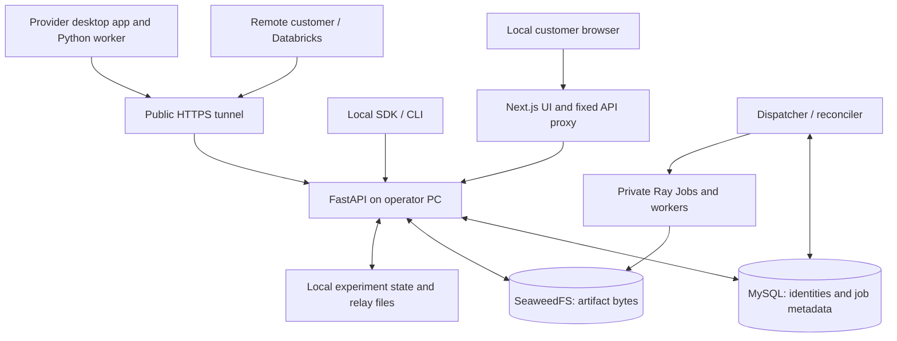
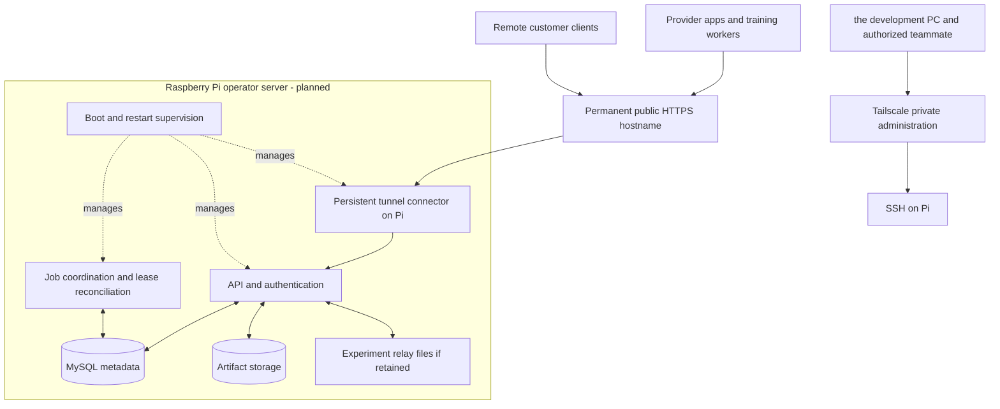

# GreenTokens: developer guide

> Publication note: machine names, private addresses and deployment URLs are placeholders. Recorded probe outcomes refer to the original private deployment, not to the example hostname. This documentation branch does not deploy the plan or publish the local experiment runtime.


GreenTokens lets a customer submit an **approved computing workload**, lets available computers execute it, and returns status, logs, metrics, and model files. The operator runs the services coordinating those computers. Providers lend computing capacity; customers submit work.

This is the authoritative overview of the **current checkout**, reviewed against source on **19 November 2026**. It describes a development/pilot system, not a production cloud. Source paths show implementation; measured reports show observed results; plans describe work that has not happened yet. Explanations of technology choices describe their engineering fit, not an undocumented historical decision.

**Hosting-plan update, 20 November 2026:** the target operator server is the stationary Raspberry Pi `operator-server`. the development PC remains the current hosting arrangement until the Pi passes readiness and migration checks, then becomes a development/administration computer. This is a plan update, not a claim that cutover or permanent public hosting has happened.

## Reading map

- [Capabilities and limits](#capabilities-and-limits)
- [System architecture](#system-architecture)
- [Target hosting structure: Raspberry Pi server](#target-hosting-structure-raspberry-pi-server)
- [Technology choices explained](#technology-choices-explained)
- [Repository and component map](#repository-and-component-map)
- [Follow a job through the system](#follow-a-job-through-the-system)
- [Networking and hardcoded addresses](#networking-and-hardcoded-addresses)
- [Data, identities, and trust](#data-identities-and-trust)
- [Run the project](#run-the-project)
- [Validation and troubleshooting](#validation-and-troubleshooting)
- [Changing the project](#changing-the-project)
- [Source, GitHub, and installed apps](#source-github-and-installed-apps)
- [Terminology](#terminology)

## Capabilities and limits

| Capability | Current implementation and limits |
| --- | --- |
| Customer web UI | Root Next.js app with mock mode and local live API mode; not a public customer login portal. |
| Local Python SDK/CLI | Standard-library client using local development identities; CLI examples cover sum and linear regression. Not published to PyPI. |
| Ray jobs | `sum_numbers_v1`, `linear_regression_v1`, and development `bert_tiny_ddp_v1`. |
| Remote provider accounts | Signup/login/logout, salted password hashes, device-bound 24-hour sessions. No password recovery or persistent keychain login. |
| Independent providers | Desktop agents poll HTTPS, run approved packages, renew leases and upload results. They do not need a Ray cluster. |
| Single-provider training | `text_finetune_v1`: approved BERT models on SST-2, CPU or usable NVIDIA GPU. Separate jobs can run concurrently on separate providers. |
| Four-PC shared model | Local experiment with HTTPS relay and periodic model-change averaging; a saved run reports success. Not a general distributed training product. |
| Databricks | Customer notebooks and HTTPS bearer adapter exist; real workspace egress, secrets and Catalog permissions require workspace-specific validation. |
| Durability | MySQL job records, SeaweedFS artifacts, plus local experiment files. Automated backup/restore is not implemented. |
| Permanent address / unattended hosting | Planned on the Raspberry Pi. Stable public HTTPS for providers, private Tailscale administration, boot/restart supervision and backups. Current the development PC launcher still uses a temporary tunnel and background processes. |
| Arbitrary code, billing, hostile-provider isolation | Not implemented. Approved code and trusted participants are pilot assumptions. |
| TrOCR | UI/contract work only; not an accepted backend template. |
| OpenViking shared agent knowledge | Future task only, recorded in [project memory and roadmap](docs/roadmap.md). Not installed or integrated. |

The generic requirements schema still uses `gpus: 0` and `execution_class: trusted_cpu`. Provider GPU selection instead uses `parameters.require_gpu` and usable CUDA capability. This is not a complete GPU allocation scheduler.

## System architecture

The **control plane** handles identity, job records, assignment and cancellation. The **execution plane** runs calculations. Metadata and artifact bytes use different storage services.

The diagram below describes the existing implementation's service relationships. The next section specifies the target host placement and operational changes; these must not be mistaken for already deployed features.



There are **two execution paths**:

1. **Ray:** the dispatcher submits a fixed driver to Ray Jobs. Ray schedules tasks/actors in a trusted cluster. The default launcher creates a local cluster; older group tools can attach multiple trusted machines.
2. **Independent providers:** remote desktop agents ask the API for jobs. The API claims rows transactionally and returns package metadata. Python workers execute packages locally. The dispatcher checks expired leases but does not submit these jobs to Ray.

Several connected computers do not automatically train one model together. Ordinary provider jobs each use one computer. The four-PC experiment explicitly coordinates replicas of one model.

## Target hosting structure: Raspberry Pi server

### Machine roles

The user reports that `operator-server` is a stationary Raspberry Pi running Debian with **8 GB RAM and 1 TB external storage**. Its exact model, CPU architecture, usable disk capacity, disk type and sustained network/storage performance still need inspection. The reported resources are a plausible starting point for the pilot control plane, not a measured capacity guarantee. Provider machines continue doing heavy training.

| Machine | Target responsibility | Relationship to availability |
| --- | --- | --- |
| Raspberry Pi `operator-server` | API/authentication, database, artifact storage, job coordination, experiment relay if retained, public tunnel connector and service supervision | Must remain powered, connected and healthy to serve providers |
| the development PC | Editor, AI coding tools, local tests, Git and remote administration | After migration, shutting it down must not interrupt the service |
| Teammate's computer | Development and authorized administration over Tailscale | Not a required runtime dependency |
| Provider computers | Installed GreenTokens app and approved training worker | Connect outward; do not need Tailscale |
| GitHub Actions runners | Build/release installers when authorized | Not needed for an already deployed backend to keep running |

### Five architectural parts



| Architectural part | What it is and why it exists | Target implementation |
| --- | --- | --- |
| **Public entrance** | Stable name and route to the API, independent of a temporary process address | Owned HTTPS hostname plus persistent tunnel on the Pi; final domain/ingress provisioning pending |
| **Control plane** | Authentication, request validation, assignment, cancellation and execution-state reconciliation | Correct FastAPI deployment plus independently supervised reconciliation; provider login must not depend on Ray starting |
| **Data layer** | Durable state and artifact bytes survive process restarts | MySQL and SeaweedFS, with data explicitly located on the external drive; experiment files handled separately |
| **Execution plane** | Computers perform calculations and report outputs | Existing HTTPS provider workers; Ray workloads require a separately validated deployment decision |
| **Operations layer** | Keeps services running and makes recovery observable | Linux service supervision, container readiness/restart policies, bounded logs, external monitoring and tested backups |

Tailscale is a separate **private administration network**. It lets developers manage the Pi; it is not required on ordinary providers and does not replace GreenTokens authentication. Merely installing Tailscale does not deploy the API or make a private endpoint publicly accessible.

### Public tunnel versus loopback

Target request path:

```text
Provider anywhere on the internet
    → https://api.<owned-domain>
    → persistent connector running on the Pi
    → http://127.0.0.1:8000 on the Pi
```

`api.<owned-domain>` is a placeholder, not an existing configured hostname. Loopback remains appropriate for the API because its connector runs on the same Pi. A provider must use the public origin, not its own `127.0.0.1` or the Pi's private Tailscale IP.

The earlier four-PC test already demonstrated app-only provider access through a public tunnel. Its workers exchanged training updates through the operator relay, not through direct worker-to-worker Tailscale connections. Moving the operator host does not require changing that fundamental topology.

Recommended public entrance: an owned hostname routed through a persistent Cloudflare Tunnel, with Tailscale kept for administration. Private Tailscale Serve alone does not satisfy app-only internet access. Tailscale Funnel is an alternative public pilot route, subject to its hostname/throughput limitations and validation. The [detailed plan](docs/server-migration-plan.md) compares these choices; none is claimed provisioned here.

### Address stability and availability are different

With a persistent hostname/tunnel identity, restarting the connector does not require generating another app endpoint. While the Pi is restarting, requests still fail until services recover. The provider already retries transient network failures, but expired sessions require sign-in and interrupted training may fail or be retried.

The connector, API, database, storage and reconciliation must all operate on the Pi without the development PC. Leaving any essential service on the development PC would preserve the developer-PC dependency. Boot/restart supervision must work without an interactive login. Ray should have a separate lifecycle so its failure does not block provider login; this requires implementation changes, not merely skipping `ray.init` in the current launcher.

This is **one server with automatic recovery**, not redundant high availability. Pi failure, external-drive loss, power outage or ISP failure can still stop service. A second tunnel connector does not replicate the database or stored models.

### Storage, migration and installer boundaries

- Explicitly place persistent database, object and experiment data on the external disk. Having a 1 TB drive attached does not mean Docker volumes use it. Require the mount before starting data services so a missing drive does not create an empty database on the boot disk.
- Back up to a separate device/location and test restoration. A second folder on the same external disk is not protection against disk failure.
- Inventory and preserve data on both the development PC and the existing Pi deployment. Drain/cancel active jobs before a consistent migration; retain accounts, device ownership, job records and matching artifact bytes. Do not run two independent writable copies as if they were synchronized.
- Existing installers contain a fixed public origin. They need one replacement targeting the final hostname and matching Tauri CSP. Ordinary later restarts or host moves behind that same hostname should not require another URL-related reinstall. Feature/security updates remain separate.
- Retain the development PC's hosting arrangement until the Pi is validated and cutover is deliberate. Once the Pi accepts new writes, rollback must preserve those writes rather than restoring stale the development PC data.

### Readiness evidence and outstanding work

Checks made on **19 November 2026**, not a live status assertion:

| Check | Observation | What it establishes |
| --- | --- | --- |
| Tailscale peer `<SERVER_TAILSCALE_IP>` | Online/active; one direct probe returned in 6 ms | Private reachability at that time, not bulk-transfer capacity |
| `https://operator-server.example.com/health` | HTTP 200; development-stub marker, no newer provider-auth marker | An existing backend responds; exact deployment version remains unknown |
| Provider login at that endpoint | HTTP 404 for an empty invalid request | Required login route was unavailable, not a wrong-password result |
| Remote `X-Dev-User: alice` usage request | HTTP 200 | Development-selector access needs correction before public rollout |
| Independent public access | Not established; external tool could not fetch the URL | Must test outside Tailscale; tool failure alone does not prove private-only routing |

Before cutover, verify the correct authenticated backend, public access from a provider without Tailscale, a complete job/artifact transfer, data restoration, and unattended reboot recovery. The decisive independence check is to turn the development PC off and confirm the Pi still serves providers. Domain choice, authorized server inspection, deployment/version reconciliation and release publication remain outstanding. See the [full migration, rollback and acceptance plan](docs/server-migration-plan.md).

## Technology choices explained

| Tool | Tool category | Where and why used here | Boundary or tradeoff |
| --- | --- | --- | --- |
| Python | Language/runtime | API, scheduling, clients, worker and ML code; fits the Python ML ecosystem. | Server environment and provider private runtime are separate. |
| FastAPI + Uvicorn | API framework + ASGI server | `core/api/`: route/dependency handling, then an HTTP process serving the app. | Does not perform training or provide automatic failover. |
| Pydantic | Data-validation library | Strict schemas reject unknown fields/templates and bound inputs. | Validation is not a sandbox. |
| MySQL | Relational database | Transactions, locks and durable rows for identity and job state. | Needs persistent volumes and backups. |
| SQLAlchemy + PyMySQL | ORM/query layer + database driver | Maps Python models/queries to SQL and carries the connection. | Editing models alone does not migrate existing tables. |
| Alembic | Schema-migration tool | Versioned database changes preserve existing installations. | Migration execution and rollback need deliberate handling. |
| SeaweedFS + boto3 | Object-storage server + S3 client | Artifact bytes stay outside relational rows; accessed through an S3-compatible interface. | Local S3 compatibility is not managed Amazon S3 or replicated storage. |
| Ray | Distributed execution framework | Trusted task/actor scheduling and cross-node execution. | Independent HTTPS providers are not Ray nodes; resource requests are not hard isolation. |
| PyTorch / Transformers / Datasets | Tensor/autograd engine / model library / dataset library | Approved workloads download models/data and compute training updates. | Downloads, runtime compatibility and GPU drivers remain dependencies. |
| React / Next.js / TypeScript | UI library / web framework / typed JavaScript | Customer dashboard, server routes, documentation and typed API adapter. | Starting port 3000 does not start the backend. |
| React / Vite / Tauri + Rust | UI / frontend build tool / native desktop shell | Provider webview calls bounded native commands for hardware and worker lifecycle. | Browser preview does not exercise the native runtime. |
| uv | Python provisioning tool | Provider app creates its own Python environment and installs training dependencies. | Does not install NVIDIA drivers. |
| Docker Compose | Local container orchestration | Runs dedicated database/storage containers with persistent volumes. | Current file lacks restart policies/healthchecks; the launcher checks readiness. |
| cloudflared | Reverse-tunnel connector | Public HTTPS reaches a local API over an outbound connection. | Temporary hostnames and a single operator PC are availability limits. |
| Tailscale | Private overlay network | Verified private connection to the Pi; planned developer/administrator access. | Not required on providers; private connectivity does not establish public API access. |
| systemd / Linux service supervision | Process lifecycle management | Planned boot startup and restart handling on Debian for API, reconciliation and tunnel. | Not yet configured/verified by this plan; cannot recover from loss of the only host or its disk. |
| GitHub Actions | CI/build/release automation | Builds installers and publishes the static download site. | Source commits, workflow builds and released binaries are separate states. |

Version authorities: [backend requirements](requirements-core.txt), [Ray requirements](requirements-smoke.txt), [web manifest](package.json), [provider manifest](apps/provider_app/package.json), [Rust manifest](apps/provider_app/src-tauri/Cargo.toml), [container images](infrastructure/compose.yaml). A caret range is not an exact installed version; consult lockfiles where present.

## Repository and component map

| Path | Responsibility | Guide |
| --- | --- | --- |
| `app/`, `components/`, `lib/` | Customer UI, API proxy, mock/live clients and inference demo | [Web app](app/README.md) |
| `core/api/`, `core/config.py` | API, request policy, authentication | [Backend](core/README.md) |
| `core/database/` | Tables, database sessions and migrations | [Database](core/database/README.md) |
| `core/artifacts/` | Object-storage writes, expiry and integrity | [Storage](core/artifacts/README.md) |
| `core/jobs/`, `core/ray_runtime/` | Scheduling, leases and Ray drivers | [Execution](core/jobs/README.md) |
| `core/workloads/` | Approved calculation/training code | [Workloads](core/workloads/README.md) |
| `apps/provider_app/` | Desktop UI, native bridge, Python worker | [Provider app](apps/provider_app/README.md) |
| `apps/provider_site/` | Static installer download page | [Download site](apps/provider_site/README.md) |
| `sdk/` | Local Python API client and CLI | [SDK](sdk/README.md) |
| `databricks/` | Remote customer notebooks and client adapter | [Databricks](databricks/README.md) |
| `scripts/`, `infrastructure/` | Startup, diagnostics, container definitions and older group tools | [Operations](scripts/README.md), [infrastructure](infrastructure/README.md) |
| `examples/` | Small pipeline examples and standalone BERT baseline | [Examples](examples/README.md) |
| `experiments/` | Research workflows and measured reports | [Experiments](experiments/README.md) |
| `tests/` | Python tests; UI tests also live beside frontend code | [Testing](tests/README.md) |
| `.github/workflows/` | Installer and site automation | [Delivery](.github/README.md) |
| `docs/` | Runbooks, contracts, roadmap and historical evidence | [Documentation index](docs/README.md) |
| `greentokens/` | Ignored separate checkout on this workstation | Not a package/submodule of the outer repository. Check which checkout your editor/server uses. |
| `.tools/`, `.venv/`, `node_modules/`, `.next/` | Local tools, dependencies and generated output | Not portable application source. |

## Follow a job through the system

### Local linear regression

1. The SDK reads JSON data and TOML configuration, then submits a job with a stable idempotency key and local identity selector.
2. FastAPI validates inputs, quotas and worker availability, then stores a `QUEUED` job in MySQL.
3. The dispatcher records an attempt before contacting Ray. This is a **database-backed durable work queue**, not a separate message broker.
4. Ray Jobs runs `core.ray_runtime.runner`, which loads persisted approved input and executes the calculation.
5. Output bytes go to SeaweedFS; their key, checksum, size and expiry go to MySQL.
6. The reconciler checks execution status. The customer retrieves status/results through organization-scoped routes.

The Ray lifecycle is `QUEUED → DISPATCHING → RUNNING → SUCCEEDED / FAILED / CANCELLED`. Fast jobs may finish between polls.

### Remote provider training

1. A provider signs in. Its session is bound to its device ID.
2. The native app starts the worker with credentials in its environment. The worker reports capabilities and long-polls `/v1/provider/work`.
3. A customer submits `text_finetune_v1`. Assignment claims a queued job under a transaction. One provider runs that job.
4. The worker downloads/checksums the approved package, executes it and renews a 90-second lease.
5. It uploads artifacts and reports completion. The API checks ownership and requires an output artifact record for success.
6. Expired leases can cause requeueing up to three total attempts. Retrying is not checkpoint resume or guaranteed exactly-once execution.

The provider loop already retries transient failures with backoff from 2 to 60 seconds while enabled. Authentication failures and a closed app are different conditions. A long outage can interrupt a job even if the worker later reconnects.

### Four providers, one model

The operator-only shared-test route creates four device-pinned jobs. Providers train locally, periodically exchange compressed weight changes through HTTPS chunks, and verify identical resulting weights at barriers. Remote rank zero averages changes. the development PC relays and coordinates; it does not train this model.

See [the experiment](experiments/four_pc_cpu/README.md). Its final measured method is periodic local training plus weight-change averaging, not the earlier proposed per-step-gradient method and not Ray DDP.

## Networking and hardcoded addresses

`127.0.0.1` means **the machine running the caller**. On the development PC it means the development PC; on a provider computer it means 333.

| Setting | Purpose |
| --- | --- |
| `127.0.0.1:3000` | Local customer Next.js app |
| `127.0.0.1:8000` | Operator's FastAPI, used by local clients and tunnel connector |
| `127.0.0.1:1420` | Provider Vite preview; not the provider API |
| `127.0.0.1:8265` | Private Ray Jobs/dashboard |
| `127.0.0.1:3307` | Dedicated MySQL container's host port |
| `127.0.0.1:8333` | SeaweedFS S3 API |
| `provider-server.json` | Public API origin compiled into provider JavaScript by Vite |
| Tauri `connect-src` | Allowed webview connection origins; must match the public origin |
| CI `GT_PROVIDER_SERVER` | Optional build-time override of the provider origin |

Remote path: **provider → public HTTPS → cloudflared on the development PC → `127.0.0.1:8000` on the development PC**. Backend loopback is intentional; a remote provider must use the public address.

The current startup script creates a **Quick Tunnel** whose hostname can change. Editing configuration does not update installed apps. Rebuilding does not update an old release asset unless the new installer is published. Re-downloading the same asset gives the same embedded address.

Permanent DNS, a persistent tunnel and supervised startup are [planned](docs/roadmap.md), not installed by these docs. Stable addressing does not keep a powered-off server available.

The updated deployment proposal uses `operator-server`, a user-reported Raspberry Pi with 8 GB RAM, 1 TB external storage and Debian, keeping the development PC for development. Its existing HTTPS backend responds, but provider login currently returns 404 and remote development selectors are accepted. Read the [specific deployment plan and verification findings](docs/server-migration-plan.md). The user wants private Tailscale administration plus public provider access; readiness, migration and automatic recovery are not yet established.

## Data, identities, and trust

- MySQL stores organizations, users, password/session hashes, workers, jobs, attempts, artifact metadata and nonbillable usage.
- SeaweedFS stores normal artifact bytes. Default expiry is 24 hours; expiry blocks reads but does not delete stored bytes. Normal size limit is 64 KiB; model-kind storage allows up to 512 MiB. A proxy may impose a smaller transfer limit.
- Experiment relay/run files are separate local data and require separate backup consideration.
- `X-Dev-User: alice/bob/admin` selects a development identity; it is not secure authentication.
- Provider password sessions are real, device-bound bearer credentials for the provider role. They do not create customer/admin access.
- Customer/operator bearer API keys use a separate mapping to existing users.

`GT_MODE=development` remains required. Proxy-header detection blocks tunneled requests from using development selectors, even though the tunnel itself reaches loopback. Changing proxy topology requires reviewing that boundary. Worker trust flags and reported hardware are not attestation; approved workloads are not a hostile-code sandbox. See [security boundaries](docs/security-boundaries.md).

## Run the project

Commands are for the **outer repository root**, in PowerShell. Avoid starting a second stack on occupied ports. Existing server orchestration is Windows-oriented; client portability does not prove server portability.

These are the current the development PC/local-development commands, not the Pi's unattended deployment instructions. The [target hosting structure](#target-hosting-structure-raspberry-pi-server) is planned separately; do not assume running this launcher on Debian completes migration or service supervision.

### Initial environment

Use Python 3.12, Docker Desktop and Node 24. For a fresh checkout:

```powershell
python -m venv .venv
.\.venv\Scripts\python.exe -m pip install -r requirements-core.txt
npm.cmd ci
```

Do not recreate a working environment routinely. If this workspace's portable Node is needed:

```powershell
$nodeDir = (Get-ChildItem .tools -Directory -Filter 'node-*-win-x64' | Select-Object -First 1).FullName
$env:PATH = "$nodeDir;$env:PATH"
```

### Start backend and web app

With Docker Desktop ready, leave this running:

```powershell
.\.venv\Scripts\python.exe -m scripts.local_stack
```

In a second terminal:

```powershell
npm.cmd run dev
```

Open `http://127.0.0.1:3000`; select **Settings → Live** for real jobs. Check `http://127.0.0.1:8000/health` separately. That route checks API/database access, not all workers, storage operations or public connectivity.

### First real job

Use an unused directory name; `init` refuses overwrites:

```powershell
$env:PYTHONPATH = "$PWD\sdk"
.\.venv\Scripts\python.exe -m greentokens check
.\.venv\Scripts\python.exe -m greentokens init onboarding-training
.\.venv\Scripts\python.exe -m greentokens explain onboarding-training/training.toml
.\.venv\Scripts\python.exe -m greentokens submit onboarding-training/training.toml
```

Use the returned ID with `status`, `wait`, `logs` and `result`. Retry uncertain submissions with the same idempotency key and input. Change the key for a new job. See [SDK](sdk/README.md).

### Remote providers

Read [operations](scripts/README.md) before running `scripts/start_server.ps1`. It starts a tunnel, edits provider source configuration and attempts to update a Databricks URL secret. It does not rebuild/publish an installer. Both backend and tunnel must remain running, and the installer must target that tunnel.

Provider `npm run dev` is a browser preview. Native execution needs Tauri or an installed desktop build; see [provider guide](apps/provider_app/README.md).

## Validation and troubleshooting

Use [component-appropriate tests](tests/README.md). Common root commands:

```powershell
.\.venv\Scripts\python.exe -m unittest discover -s tests -p test_core.py
.\.venv\Scripts\python.exe -m unittest discover -s tests -p test_sdk.py
.\.venv\Scripts\python.exe -m unittest discover -s tests -p test_provider_auth.py
npm.cmd test
npm.cmd run lint
npm.cmd run typecheck
```

| Symptom | Check |
| --- | --- |
| Website works, provider cannot connect | UI port 3000 is not API port 8000; verify API, public tunnel and installed origin independently. |
| Reinstall does not fix connectivity | Compare release/build origin, version and checksum; the download may be unchanged. |
| Public health succeeds, login fails | Check embedded URL, CSP, auth route, expired session and actual installed version. |
| Dashboard works without backend | Mock mode simulates jobs. |
| No eligible worker | Check recent heartbeat, worker kind, pause state and required capabilities. |
| GPU detected but unusable | PyTorch must report usable CUDA; a device name is insufficient. |
| Startup fails at Ray | Inspect sanitized errors and available memory; API startup is currently coupled to Ray. |
| Edits have no visible effect | Check outer versus nested checkout and which directory the server uses. |
| Results become inaccessible | Check artifact expiry and storage health. |

Do not print full environment dumps, credential files or Docker inspection/configuration output: these can contain secrets.

## Changing the project

1. Identify execution path and user role before editing. Provider features are not automatically Ray features.
2. Follow component guides to implementation and tests. Reuse existing helpers, as required by [AGENTS.md](AGENTS.md).
3. Treat schemas, clients, persistence and runtime as one contract. A UI template name alone does not implement training.
4. Use migrations for schema changes; do not reset volumes to hide upgrade problems.
5. Change provider origin and Tauri policy together; verify the packaged installer separately.
6. Update component docs when behavior changes. Label implemented, tested, deployed and planned separately.

## Source, GitHub, and installed apps

At this audit, the outer branch was `feat/bert-training-and-live-usage`, commit `84dfecf`, matching its remote feature branch. This is a dated observation, not a live deployment dashboard.

- The new temporary provider origin was an uncommitted local edit.
- Four-PC experiment files and associated API edits were local additions/modifications; run outputs are ignored by Git.
- The nested `greentokens/` checkout is ignored by the outer repository.
- `main`, a feature branch, release tag, downloadable binary, running process and local working tree can all differ.
- Documentation is published separately on `developer-plan-update` under the commit title `11/20/2026 push`; this does not deploy services or publish an installer.

A teammate must select `developer-plan-update` to receive these guides; the default branch is not updated by this documentation push. Local experiment implementation and ignored outputs remain excluded. Check `git status --short`, `git log -1` and actual release records before describing a feature as delivered.

## Terminology

| Term | Meaning here |
| --- | --- |
| Control plane | Services deciding access, assignment and job state. |
| Execution plane | Processes/computers performing calculations. |
| Long polling | Worker requests work; server holds the response briefly while waiting. |
| Heartbeat | Recent report of availability; not proof of correct computation. |
| Lease | Time-limited assignment that the worker renews. |
| Reconciler | Loop comparing database state with runtime reality. |
| Idempotency key | Caller identifier used to recognize repeated submissions. |
| ORM / migration | Python-to-SQL model mapping / versioned persistent schema change. |
| Object storage / artifact | Key-addressed file service / saved output or model. |
| Checkpoint | Saved model state for inference or, when supported, resuming training. |
| Reverse tunnel | Outbound connector carries public requests back to a local service. |
| CORS / CSP | Browser cross-origin response policy / webview content and connection policy; not authentication. |
| Native bridge / IPC | Controlled calls from desktop web UI into Rust commands. |
| Data parallelism | Replicas process different data and coordinate model updates. |
| Local SGD | Multiple local optimization steps between synchronization rounds. |
| CI / release artifact | Automated checks/builds / compiled downloadable output. |

Continue with the [documentation index](docs/README.md).
