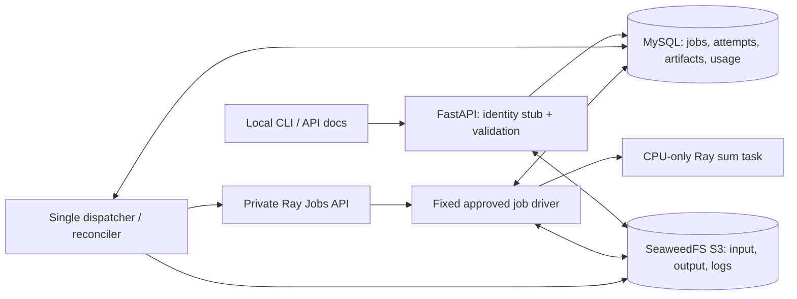

# Local control-plane architecture

API, dispatcher, and Ray job driver are separate processes. API restarts cannot
erase queued jobs or execution records. Alembic owns schema creation; the API
never creates tables at startup. The launcher seeds only local development users
and publishes trusted runtime resource capacity with a heartbeat.

The dispatcher holds a MySQL advisory lock to ensure a single process owns
dispatch, and checks lock ownership before every tick. It claims a queued row
under a transaction and commits an attempt with a unique Ray submission ID.
Submission intent is committed before the network call. Recovery polls that ID;
an ambiguous missing submission is not executed again. If it cannot be found
after the 60-second grace period, the attempt fails as `EXECUTION_LOST`.

`QUEUED -> DISPATCHING -> RUNNING -> SUCCEEDED / FAILED / CANCELLED` is the normal
lifecycle. Fast jobs can pass directly from DISPATCHING to a terminal state
between polls. Cancellation is persistent, and running jobs are not reported
cancelled until Ray confirms a terminal state. The runtime limit includes a
60-second launch grace; the driver's `ray.get` separately bounds task execution.

The driver reads only the persisted approved template, verifies stored inputs,
runs its fixed task, and writes output to S3 before committing artifact metadata.
The reconciler checks Ray status, stores logs, verifies output integrity, and
commits a terminal state plus a uniquely constrained nonbillable usage record.
Missing or corrupt output cannot become successful. Customer parameters never
become shell commands, repository URLs, runtime environments, or object keys.

Results live outside MySQL. MySQL contains ownership, object keys, SHA-256, size,
expiry, timestamps, and worker/attempt metadata. The API verifies ownership and
expiry before fetching an object and checks its size and SHA-256 before delivery.

The local S3 implementation is interchangeable through boto3. The MySQL 8.4 image
tracks the 8.4 maintenance line; SeaweedFS and all direct Python dependencies are
version pinned. Transitive Python dependencies and image digests are not locked.
