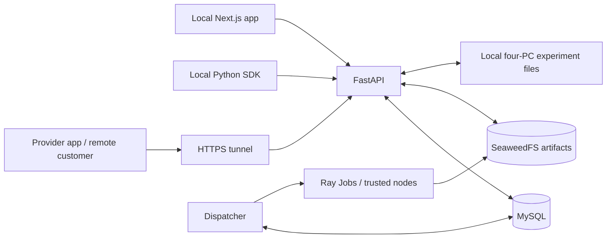

# Current architecture reference

Reviewed 19 November 2026. The [root README](../README.md) is the full developer guide; this page is a compact architecture reference for existing links and the web documentation viewer.

## Services and responsibilities

The **control plane** consists of API, persistence and reconciliation. Computation happens either in trusted Ray tasks/actors or in independent provider subprocesses. These paths share job/artifact concepts but have different assignment and failure semantics.

## Ray path

The dispatcher owns a MySQL advisory lock, claims one eligible Ray job, persists an attempt/submission ID and asks Ray Jobs to run the approved driver. Reconciliation checks runtime state, cancellation, logs and output integrity. Ambiguous lost execution fails rather than blindly re-executing. See [execution](../core/jobs/README.md).

## Provider path

Authenticated desktop workers heartbeat and long-poll the API. Transactional assignment gives each worker one approved package and an attempt with a 90-second renewable lease. Workers upload outputs and report completion. Expired leases can requeue ordinary work up to three total attempts. The dispatcher handles expiry; it does not launch these workers through Ray. See [provider app](../apps/provider_app/README.md).

## Shared training experiment

Four device-pinned provider jobs train replicas, exchange compressed model changes through HTTPS relay files, average on remote rank zero and validate identical synchronized weights. The operator coordinates and stores bytes. This experiment uses local state and an in-process lock; it is not a horizontally scalable distributed coordinator. See [experiment](../experiments/four_pc_cpu/README.md).

## Persistence and boundaries

MySQL stores metadata/identity, SeaweedFS stores normal artifacts, and the experiment additionally stores files on the operator disk. API restart does not erase database rows, but this does not guarantee uninterrupted jobs, replicated data or backup recovery.

The API remains loopback-bound. A local tunnel connector exposes selected routes through public HTTPS; bearer authentication is required for detected proxy calls. The customer website still uses local development selectors. See [security boundaries](security-boundaries.md).

The default launcher starts Ray before the API, so a Ray startup failure can block provider login. Permanent hosting, API/Ray lifecycle separation and automatic recovery are [planned](roadmap.md), not implemented by these documents.
