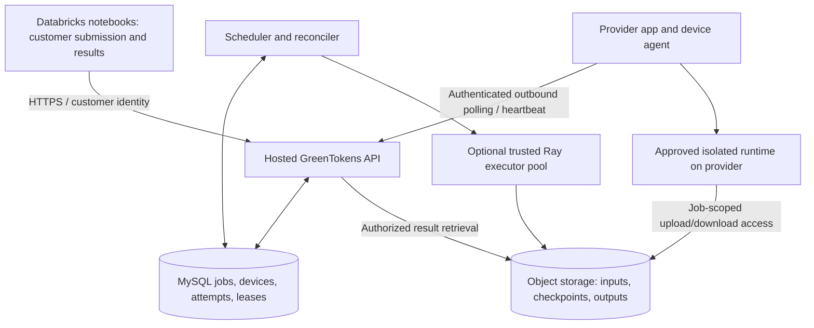

**GreenTokens provider architecture review and migration plan**

16 November 2026. Reviewed the supplied assessment against the working checkout on `feat/bert-training-and-live-usage`, HEAD `d317a6c`, including the existing untracked provider diagnostic scripts. This is a source review and focused unit-test run, not proof of a deployed Databricks workspace, internet-connected provider network, installer release, or multi-computer training run. No application code was changed for this review.

**Decision**

The proposal is directionally correct and solvable as an incremental product. GreenTokens should operate its own independently hosted control plane, with Databricks as the sole customer-facing workflow for now. Providers should enroll devices and opt into supported work through a desktop app; they should not operate the shared scheduler or manually manage Ray groups.

However, “any computer, any workload, any network” is not a defensible first release. Define universal as an extensible catalog of approved workloads matched to a tested hardware/runtime matrix. Start with vetted providers and public/non-sensitive datasets. Supporting arbitrary hostile hosts, private business training data, and unreliable wide-area synchronized training is a substantially harder product.

The statement that Claude has misunderstood the goal cannot establish intent. The concrete finding is that the current provider execution path implements a trusted LAN group experiment, and making that path the production design would conflict with the intended product.

**What the current code actually implements**

| Area | Evidence | Assessment |
| --- | --- | --- |
| Provider desktop app | `apps/provider_app/src/screens/`, Tauri shell | Exists; preserve the app, consent, hardware, preferences, and activity views. Replace group-oriented actions. |
| Provider login | `src/services/liveProviderService.ts:43` returns a local display name and device ID | UI-level local identity, not authenticated provider registration. |
| Runtime bootstrap | `src-tauri/src/agent.rs:78` creates managed Python and installs pinned Ray with bundled uv | Automatic installation already exists. It is not a complete approved-workload runtime manager. |
| Hardware detection | `src-tauri/src/hardware.rs:8`, bundled Windows detection script | Windows and macOS detection code already exists; do not rebuild it. Central capability registration and execution probes are missing. |
| Local utilization | `src-tauri/src/usage.rs`, `src/services/usage.ts` | Real sampling code exists. The “training” indicator is a process/CPU heuristic, not authoritative job assignment or billing proof. |
| Group creation | `src-tauri/agent/gt_agent.py:112` uses `ray start --head` or `--address` | Provider-owned group head, LAN/IP-dependent membership. This is the main architectural conflict. |
| Stop behavior | `gt_agent.py:107`; Rust `stop_on_exit` | Runs `ray stop`; starting a group also calls stop first. It is not scoped by an owned task identifier, and may affect other same-host Ray processes. Stopping a head disrupts its group; it does not necessarily stop every backend process. |
| Reconnection | `src/hooks/useProvider.tsx` and `liveProviderService.ts` | Preferences/group remembered, participation deliberately not persisted; status polling detects loss but is not automatic reconnect. Preserve owner consent when changing this. |
| Backend-to-group bridge | `scripts/local_stack.py:127`, `--attach` | A bridge already exists: the backend can attach to an agent-hosted group. The systems are not completely disconnected, but this path retains the host/local-address assumptions. |
| Worker inventory | `core/database/models.py:34`, `scripts/local_stack.py:99` | Inventory is derived from live Ray nodes, not independently enrolled devices. `trusted` defaults true, unsuitable for public self-registration. |
| API and customer auth | `core/api/main.py:55`, `core/config.py` | Hashed bearer-key lookup exists, plus a local identity stub. Production remains disabled; loopback and proxy-header assumptions are not an independently deployed production authentication design. |
| Workloads | `core/api/schemas.py`, `core/workloads/bert_tiny.py`, `core/workloads/ddp.py` | Three approved templates exist: sum, linear regression, and BERT. Reusable recipe/orchestration separation has started. |
| Databricks | `databricks/01_Submit_Training_Job.py`, `02_View_Results.py`, `greentokens_client.py` | Submit/status/result/model retrieval code and summary mapping exist. A real workspace execution was not verified in this review. |
| Durable jobs/artifacts | `core/jobs/dispatcher.py`, `core/database/models.py`, `core/artifacts/storage.py` | Strong foundations to reuse: job/attempt state, idempotency, cancellation, checksums, ownership checks, expiry, model artifact handling. |

Paths beginning `src/` or `src-tauri/` in the table are relative to `apps/provider_app/`.

Documentation needs reconciliation. The provider README says jobs are not sent to groups and later says the installer is UI-only, while the code contains an agent bootstrap and an attach path. The Databricks README/client comment says bearer authentication is absent, but `core/api/main.py` implements it. Older architecture/security docs still describe a sum-only system. These are documentation defects, not proof that the new paths have been deployed successfully.

**Important qualifications to the proposed architecture**

1. No provider should own the shared control plane. This does not mean no coordinator can exist. Ray heads, rendezvous services, reducers, or rank-zero workers still have technical roles. Keep authority with GreenTokens, scope worker roles to a job, and define replacement/failure behavior.
2. An authenticated outbound HTTPS connection is sufficient for registration, polling, leases, and many independent jobs. It does not provide the distributed-training data path automatically. Gradient/model exchange still requires reachable authenticated endpoints, an overlay or relay if necessary, bandwidth planning, and timeouts.
3. Reconnect should restore the same device identity and only resume participation when the owner has enabled that policy. Network loss must not undo an explicit Pause. Reconnection also does not guarantee an interrupted distributed job can continue without checkpoint/restart logic.
4. Ray should remain inside a trusted execution boundary. Its token authentication is additional access control, not isolation between unrelated providers or customer workloads. Ray explicitly places security/isolation outside the cluster: [Ray 2.60 security](https://docs.ray.io/en/latest/ray-security/index.html).
5. Docker/VM isolation can constrain a workload's access to a provider's host. Ordinary containers do not hide customer data or model weights from the provider who controls that host. Preventing hostile-host inspection requires a separate trusted/confidential-computing design with platform limitations. Do not advertise mutual confidentiality based on Docker alone. [Docker security](https://docs.docker.com/engine/security/).
6. Self-reported hardware and checksums are not proof of honest computation. Capability probes, provider admission policy, result validation, and eventually fraud controls are separate from artifact integrity.
7. Windows/macOS app support and distributed-executor support are different promises. Ray's supported multi-node platform is Linux; Windows/macOS opt-in is experimental. Preserve native apps, but publish a tested executor matrix and initially constrain distributed jobs to a qualified environment. [Ray platform support](https://docs.ray.io/en/latest/cluster/getting-started.html).
8. Databricks-only means notebooks are the customer surface; GreenTokens still needs its own API/control plane. Verify outbound connectivity from the actual workspace first. Free Edition limits outbound domains, and enterprise network-policy controls are not automatically available there. [Free Edition limitations](https://docs.databricks.com/aws/en/getting-started/free-edition-limitations), [serverless network policies](https://docs.databricks.com/aws/en/security/network/serverless-network-security/manage-network-policies).

**Recommended target**

For the first remote-provider milestone, reuse FastAPI and MySQL for an authenticated pull protocol with atomic job leases; no new message broker is necessary initially. Providers request work, the scheduler selects a compatible available device, and the agent runs the approved package with constrained input/output access. Ray can continue serving the existing trusted jobs or coordinate trusted backend tasks. A remote agent is not automatically a Ray worker; this execution adapter must be built explicitly.

Keep distributed training as a separate job type requiring a reserved compatible cohort and a tested communication path. Do not migrate the existing direct Ray actor exchange to arbitrary public providers merely by exposing its head. A job-private Ray deployment may be one later executor option, but still requires network and host isolation; a job-specific token is not sufficient.

**Files to preserve or change**

| Existing location | Minimum treatment |
| --- | --- |
| `apps/provider_app/src/screens/Hardware.tsx`, `src-tauri/src/hardware.rs`, `src-tauri/src/usage.rs` | Preserve detection/display; reuse measurements in heartbeats. Add capability probes rather than infer readiness from GPU name alone. |
| `apps/provider_app/src/screens/Home.tsx`, `src/components/GroupCard.tsx`, `src/types/provider.ts`, `src/hooks/useProvider.tsx` | Replace host/join roles with device enrollment, availability, assignment, and opted-in reconnect states. Stop persisting bearer-equivalent group codes in webview localStorage. |
| `apps/provider_app/src/services/ProviderService.ts`, `liveProviderService.ts` | Keep interface boundary; implement real enrollment, heartbeat, claim, pause/drain, revoke, and completion operations. |
| `apps/provider_app/src-tauri/src/agent.rs`, `src-tauri/agent/gt_agent.py` | Reuse managed runtime bootstrap, validation, and hidden-process invocation. Add a supervised outbound agent, OS credential storage, runtime verification/cache, and task-owned process lifecycle. Retire broad `ray stop` from the product path. |
| `core/api/main.py`, `core/config.py` | Separate explicit local and hosted modes. Require customer/device authentication on the hosted API, with scoped authorization and configured ingress trust. Do not merely remove loopback checks. |
| `core/database/models.py`, existing migrations directory | Retain jobs/artifacts; migrate for provider/device ownership, credentials/revocation metadata, capability/runtime inventory, leases, fencing generations, and assignments. Separate device identity from ephemeral Ray node IDs. |
| `core/jobs/dispatcher.py` | Retain durable reconciliation; add atomic lease/reservation selection, stale-device handling, cancellation, expired-attempt handling, and rejection of late completions. The current one-in-flight-job policy can remain for the first pilot. |
| `core/ray_runtime/client.py`, `runner.py`, `scripts/local_stack.py` | Retain trusted local executor for development. Remove provider-hosted-head/local filesystem assumptions from the new production executor path. Keep internal DB and S3 credentials off provider devices. |
| `core/api/schemas.py`, `core/workloads/bert_tiny.py`, `ddp.py` | Keep approved workload schemas/recipes. Introduce versioned workload/runtime manifests; audit the synchronization implementation before promising distributed accuracy or recovery. |
| `core/artifacts/storage.py` | Keep object storage and ownership/integrity checks; add narrowly scoped transfers, checkpoint lifecycle, and measured size/retention policies. Current model limit is 64 MiB. |
| `databricks/greentokens_client.py`, `01_Submit_Training_Job.py`, `02_View_Results.py` | Preserve customer flow. Package the SDK with the notebooks; importing only the Databricks folder does not satisfy the sibling `sdk` import by itself. Persist/display request IDs before network submission for uncertain retries. |
| `docs/architecture.md`, `docs/security-boundaries.md`, provider and Databricks READMEs | Reconcile descriptions with implemented code and clearly separate verified, experimental, and planned capabilities. |

New protocol/executor modules will be needed, but their filenames are implementation choices, not files already present. Avoid starting a frontend rewrite or choosing dependencies before that contract is agreed.

**Specific training-code concerns**

The BERT path has genuine distributed-training machinery in source: `STRICT_SPREAD` Ray placement, per-worker shards, initial-weight synchronization, and collective exchange. It is not simply several unrelated runs. However, code presence is not measured multi-computer success.

- `sync_every=1` averages gradients; the default `sync_every=50` averages model parameters after local AdamW updates. Describe the latter as periodic model averaging/local training, not PyTorch DDP or mathematically identical per-step training. Optimizer states are not averaged.
- `weights_identical_on_all_computers` is inferred from equality of rounded sums of parameters. Different parameter vectors can have the same sum. Replace that evidence with exact tensor comparison or strong canonical checkpoint hashes, and verify a saved checkpoint by reloading it.
- `global_batch // world` silently rounds down. Require divisibility or report/implement the actual global batch.
- Actor-count spread establishes distinct Ray nodes, not independently attested physical machines. Record device identities, node IDs, ranks, and actual execution evidence; hostnames alone are not proof of distinct owners/hardware.
- The exchange waits for all participants; there are outer timeouts, but no complete lease/checkpoint recovery design. The placement group's readiness wait occurs before its cleanup `finally`, so a reservation-readiness failure can bypass cleanup. Ensure actors/reducer/reservations and outputs are cleaned up on every failure path.
- The current BERT admission path counts fresh CPU-capable workers; it does not validate a full training runtime/memory/GPU compatibility contract. GPU requests and the provider agent are currently CPU-only.

**Shortest practical migration plan**

| Phase | Deliverable | Exit condition |
| --- | --- | --- |
| 0. Freeze the boundary | Record Databricks-only customer scope, preserve LAN mode as an internal experiment, choose hosted environment and initial provider/runtime matrix | Team agrees on supported workloads, trust assumptions, data policy, and stop/reconnect behavior |
| 1. Hosted control plane | Independently run existing API, dispatcher, DB, and storage with explicit hosted auth and TLS; validate Databricks egress early | Databricks submits and retrieves a reference job after the developer laptop is turned off |
| 2. Device enrollment | Persistent authenticated device identity, revocation, heartbeat, capabilities, opt-in reconnect; reuse desktop UI and detectors | Same device reconnects after network/restart; revoked device is rejected; Pause remains respected |
| 3. First remote job | Atomic lease, scoped data transfer, one approved isolated CPU workload, bounded execution and completion validation | A provider on a second network executes a Databricks-submitted job without inbound router setup; a failed provider cannot leave an indefinite job |
| 4. Runtime catalog | Verified versioned packages, platform/architecture/driver matching, disk limits, cache reuse, cleanup, and update/rollback policy | Same provider runs two supported job types without manual pip commands or reinstalling the app |
| 5. Qualified distributed training | Reserve a compatible cohort, establish a private data path, choose and document synchronization semantics, checkpoint and recover/fail safely | Two providers train one model with independent execution evidence; repeat with four and measure network/synchronization cost |
| 6. Broaden support | Add tested Windows/macOS/Linux executor combinations and GPU backends one at a time | Each capability is enabled only after its compatibility, isolation, failure, and performance checks pass |

Do not promise a calendar deadline from this review. Hosting/access, Databricks edition and network policy, target OS/hardware, isolation choice, and dataset confidentiality determine the effort. A vetted-provider pilot is a much smaller milestone than an unrestricted public compute marketplace.

**Acceptance tests and evidence**

Keep the requested connection, execution, and reconnect tests, but they must cover meaningful failure conditions: unauthorized/revoked device, foreign job data, duplicate or expired lease completion, interrupted transfer, provider loss, explicit Pause, and bounded process/resource cleanup. These are essential protocol checks, not optional test-suite expansion. Retain existing security regression tests.

Checks run during this review: 27 core unit tests, 4 Databricks client unit tests, and 8 provider-agent unit tests passed (39 total). Core tests use test doubles/in-memory services; Databricks tests mock transport; provider-agent tests do not start a Ray cluster. No desktop build, new cloud deployment, live Databricks workspace, or cross-network training was validated. No dependencies were installed for this review.

**Recommendation**

Approve the architecture direction with the qualifications above. First prove: Databricks submits a job to an independently hosted GreenTokens service, an enrolled provider on another network executes it, and the result returns even though the developer laptop is offline. Then prove runtime reuse and failure recovery. Multi-provider synchronized training should be a separately measured extension of that working provider platform.
