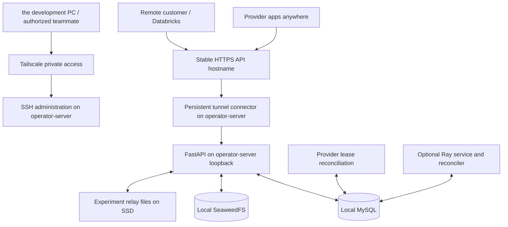

# Plan: move the GreenTokens operator server to operator-server

> Publication note: machine names, private addresses and deployment URLs are placeholders. Recorded probe outcomes refer to the original private deployment, not to the example hostname. This documentation branch does not deploy the plan or publish the local experiment runtime.


Status: **plan updated after read-only checks of an existing Pi backend; no deployment, migration, DNS change or service installation performed in this task.** Updated 19 November 2026. [System guide](../README.md) · [Roadmap](roadmap.md)

## 1. Decision and evidence

Use the stationary Linux machine `operator-server` as the proposed operator host. the development PC becomes a development/administration computer rather than the runtime dependency for provider connections.

Verified from the development PC: Tailscale reported `operator-server` online/active at `<SERVER_TAILSCALE_IP>`, and one direct peer probe returned in 6 ms. the development PC's Tailscale address was `<DEVELOPER_TAILSCALE_IP>`. This proves private connectivity at that moment, not server capacity, SSH access, GreenTokens installation, internet upload throughput or future uptime.

The user confirms operator-server is a stationary Raspberry Pi with **8 GB RAM, 1 TB external storage and Debian Linux**, intended to remain powered on. These specifications are user-reported. Exact Pi model, 64-bit architecture, disk type/filesystem/health, free capacity, service configuration, power/network reliability and administrative access still require inspection.

**Conclusion:** this can remove dependence on the developer laptop and provide a stable API with automatic recovery. It is still a single-server deployment, not high availability during host, disk, site-power or ISP failure.

### Existing backend checks

The user supplied `https://operator-server.example.com`. Read-only/invalid-input probes from the development PC produced:

| Probe | Observed result | Interpretation |
| --- | --- | --- |
| `GET /health` | HTTP 200; `status: ok`, `authentication: development-stub`; no `provider_auth` field | A backend is already reachable; it does not advertise the newer provider-login implementation |
| `GET /v1/usage`, no credentials | HTTP 401 | Anonymous request rejected |
| `GET /v1/usage`, `X-Dev-User: alice` | HTTP 200; response body not printed | Remote callers can use the local development selector through this ingress |
| `POST /v1/provider/auth/login`, empty invalid JSON object | HTTP 404 | Provider login is unavailable at the supplied endpoint; this is not an incorrect-password response |

The endpoint appears to expose an older or differently routed deployment than the current local source. Exact deployed commit/process configuration is not known. Do not claim that rebuilding the desktop app alone will fix it.

An external web-fetch tool could not access the URL. This is **inconclusive**, not proof of private-only routing: tool/network restrictions can also cause failure. On the Pi, inspect `tailscale serve status` and `tailscale funnel status`, then test from an independent device with Tailscale off. Neither local peer connectivity nor HTTPS syntax proves public accessibility.

**Blocking readiness issue:** do not open broader public access until the deployed API rejects remote development selectors and exposes the intended provider authentication routes. Preserve the current access policy while auditing; do not enable Funnel to diagnose a login-route problem.

## 2. Separate three requirements

| Requirement | Mechanism | What it does not solve |
| --- | --- | --- |
| Reachability | Tailscale for private administration; HTTPS ingress for providers | A running service or sufficient permissions |
| Address stability | A retained DNS name, independent of the current server process | Backend outages or expired application sessions |
| Availability/recovery | Boot services, restart supervision, readiness checks, power/network and backups | Continuous service during loss of the only host |

Installing Tailscale addresses the first requirement for permitted peers. It does not start FastAPI, migrate MySQL or give a non-Tailscale user access to a `100.x` address.

## 3. Recommended network design

**User-confirmed access model:** provider owners install only GreenTokens; Tailscale is for administration. Therefore private Serve alone does not satisfy the deployment goal. No exposure is authorized merely by this plan.



**Every runtime component shown after Public runs on operator-server**, not the development PC. In particular, the public connector must move with the backend; keeping it on the development PC would preserve the laptop dependency. Provider training stays on provider computers. No GPU is needed merely to accept accounts, assign jobs and store results. The Pi does not need to train models; prioritize its RAM, disk I/O and upload bandwidth for the control plane.

### Access choices

| Choice | Who can connect? | Fit and remaining work |
| --- | --- | --- |
| Tailscale + Serve | Authorized Tailscale peers over private HTTPS | Good first validation path or a closed team; every provider needs Tailscale access. Databricks egress cannot be assumed to reach the tailnet. |
| Tailscale + Funnel | Internet clients through a node's HTTPS `*.ts.net` address | Possible public pilot without a purchased domain; retain node/domain identity. Current docs label Funnel beta and impose non-configurable bandwidth limits. Measure artifact/training traffic before choosing it. |
| Tailscale administration + owned hostname + persistent Cloudflare Tunnel | Ordinary internet clients; no Tailscale installation required on providers | Recommended for the install-once product goal. Needs a domain/account and configured persistent route. Application authentication still required. |

Tailscale Serve is private; Funnel is public. Funnel is limited to tailnet-domain names and certain TLS ports; it is not an arbitrary custom-domain hosting feature. Avoid baking a temporary test origin into a widely distributed installer. References: [Serve](https://tailscale.com/docs/features/tailscale-serve), [Funnel](https://tailscale.com/docs/features/tailscale-funnel).

For the recommended public path, route `https://api.<owned-domain>` to `http://127.0.0.1:8000` through a persistent connector on operator-server. Keep that external hostname when later changing physical hosts. This does not require a static home public IP or router inbound forwarding. A domain and correct routing are still prerequisites. [Cloudflare setup](https://developers.cloudflare.com/tunnel/get-started/).

### Binding and trust details

- Keep MySQL `3307`, S3 `8333`, API `8000`, and optional Ray Jobs `8265` on host loopback under the proposed host-process layout.
- Do not simply bind the API to `<SERVER_TAILSCALE_IP>` or `0.0.0.0`. Current middleware rejects nonloopback clients, and the local identity stub must not become a remote authentication mechanism.
- Tailscale Serve/Funnel or another reverse proxy connects locally to the API. Before use, explicitly verify bearer enforcement and real client-address handling. Current proxy detection is based on selected headers; never assume a different proxy reproduces Cloudflare headers or rate-limit identity.
- The provider frontend accepts HTTPS remote origins; raw `http://<SERVER_TAILSCALE_IP>:8000` is not a supported configured origin. Use private/public HTTPS, not a weakened URL validator.
- Restrict administrative SSH access to intended operators using tailnet policy and host authorization. Ordinary provider identities should not receive database, Docker or SSH access.
- Retain the server's Tailscale identity, restrict its permissions and review key-expiry policy for unattended use. Do not force reauthentication remotely without another recovery route. [Server key expiry](https://tailscale.com/docs/features/access-control/key-expiry).

## 4. Hardware and platform acceptance gate

Before provisioning, collect read-only facts through an authorized SSH account or local terminal:

```sh
uname -m
cat /etc/os-release
nproc
free -h
df -h
lsblk -o NAME,SIZE,TYPE,FSTYPE,MOUNTPOINTS
```

Also inspect existing services/port use, storage health, internet upload/download capacity and whether the host can reboot unattended. Do not collect environment variables, keys or whole configuration dumps.

Provisional planning budget for a few providers: 64-bit Linux, roughly four CPU cores and 8 GB RAM, SSD storage with tens of GB free plus model/backup capacity. **This is an engineering starting point, not a measured minimum or a hardware certification.** Small-memory systems may require tuning; keep Ray/training off a constrained control host. A microSD-only system is a poor durable database/large-relay default; assess SSD/USB storage, write endurance and power stability.

Confirm this Debian installation is 64-bit ARM64 rather than assuming all Raspberry Pi installations are. Verify the exact pinned Python packages and MySQL/SeaweedFS images have compatible artifacts before installation. Ray documents Linux x86_64/aarch64 support, but that does not certify all pinned wheels or the host's resources. [Ray installation](https://docs.ray.io/en/latest/ray-overview/installation.html).

The four-PC experiment is much heavier on uplink/disk than login and job polling: chunks, model replicas and final archives all traverse the server. The recorded 6 ms ping measures latency, not bulk throughput. Test representative 8 MiB chunks and model uploads through the selected ingress; verify proxy body/time limits independently of the backend's 512 MiB model allowance. Do not select an ingress based only on `/health`.

### Put the data on the external disk deliberately

Having a 1 TB drive attached does not mean Docker volumes use it. Inspect the actual data paths and free space. Proposed layout: mount the external drive by persistent filesystem UUID at `/srv/greentokens-data`, with separate database, object and experiment directories. Use a Linux-native filesystem suitable for database permissions/durability; do not reformat an existing drive without checking its contents and obtaining explicit authorization.

Make data services require the mount (for example, systemd mount dependencies/`RequiresMountsFor` in the eventual service definitions). If the drive is absent, fail readiness rather than silently creating empty database/storage directories on the Pi's boot disk. Backups need a second device/location; another directory on this same 1 TB disk does not protect against its failure. Confirm external-drive power stability and thermal behavior under sustained I/O.

## 5. Proposed service layout on Linux

Use host Python services under systemd and existing database/storage containers under Docker Engine. This minimizes changes to current loopback assumptions. Do not reuse Docker Desktop as the server's boot dependency.

| Proposed service | Lifetime / role | Dependency and recovery policy |
| --- | --- | --- |
| Tailscale daemon | Private management connection | Boot-enabled; independent of GreenTokens |
| Docker Engine | Runs MySQL and SeaweedFS | Boot-enabled; protected persistent volumes |
| MySQL / SeaweedFS containers | Durable records and artifact bytes | Explicit restart policy plus real readiness checks |
| One-shot migration task | Upgrades schema before new app version runs | Run once with serialization; failure blocks deployment, not repeated uncontrolled migrations |
| GreenTokens API service | HTTP login, assignment and artifact routes | Depends on prepared configuration/schema; bounded restart/backoff; no interactive shell required |
| Provider reconciler service | Expires leases, requeues/fails ordinary provider work | One owner using existing lock semantics; remains available without Ray |
| Ray runtime / Ray reconciler | Optional trusted Ray templates | Separate lifecycle; failure must not prevent provider login |
| Persistent tunnel service | Public origin → API loopback | Boot-enabled, reconnect/restart; no new hostname on process restart |
| Backup/check timers | Coherent data backups, disk checks and monitoring | Report failure; recovery tested on a separate target |

These service names/layouts are proposed, not files already installed. Use one supervisor per process. Docker restart policies restart exited containers; an unhealthy healthcheck alone does not necessarily restart a still-running process. Explicit readiness/recovery logic is needed. `unless-stopped` preserves deliberate manual stops, so document how maintenance exits that state. [Docker restart semantics](https://docs.docker.com/engine/containers/start-containers-automatically/).

Suggested deployment directories: reviewed source release under `/opt/greentokens`, persistent application/experiment data under `/var/lib/greentokens`, and logs through bounded journald retention. The current experiment path is repository-relative, so moving its data requires an explicit path/configuration change or an intentionally preserved stable deployment path. Do not deploy a new source directory and accidentally abandon run state.

Run app services as a dedicated unprivileged identity. Provision secrets using an approved external/service credential mechanism; do not commit them, put them in shell history, or print them in generated plans. Current `Settings.from_env()` expects environment values, so adapt runtime credential delivery deliberately. Preserve key mappings/password hashes when migrating; generating a fresh empty database does not migrate accounts.

## 6. Specific repository changes needed

| Existing source | Required implementation work before migration |
| --- | --- |
| `scripts/local_stack.py` | Preserve local developer launcher; add a Linux server startup path with explicit readiness/migration stages and no mandatory `ray.init` before API availability |
| `core/jobs/dispatcher.py` | Decouple provider lease reconciliation from eagerly constructing `RayJobs`; preserve singleton ownership and prevent double reconciliation when Ray is enabled |
| `core/api/main.py`, `core/config.py` | Define server/proxy authentication boundary explicitly; test that remote development-selector requests fail; add suitable readiness checks without exposing credentials |
| `core/ray_runtime/client.py` | If retaining Ray on Linux, verify entrypoint quoting (`subprocess.list2cmdline` is Windows-oriented), paths and secret-handoff permissions; avoid carrying developer workstation paths |
| `infrastructure/compose.yaml` | Add deployment-specific restart/readiness/resource/storage settings without silently disrupting the current local environment |
| New Linux service definitions | API, reconciliation, optional Ray and connector lifetimes, restart limits and logs; reuse native platform facilities before adding libraries |
| `apps/provider_app/provider-server.json` and Tauri config | One stable HTTPS origin and matching `connect-src`; verify any CI `GT_PROVIDER_SERVER` override |
| `lib/proxyPolicy.ts` | Decide how operator UI reaches the new backend; current upstream is local loopback and current UI uses local development identities |
| `app/api/demo/predict/route.ts` | Keep the workstation demo local initially; its hardcoded Windows Python path is not portable server deployment code |
| `core/api/shared_test.py` and experiment files | Transfer persistent run data and review paths; retain one API coordinator until its process-local lock/file design is changed |
| Release/download configuration | Build, verify and deliberately publish an installer targeting the stable origin; source changes alone are insufficient |

Do not advertise all Ray templates as available if the initial server profile runs provider-only. Either validate/migrate the Ray path too, or explicitly scope the first release and reject unavailable templates clearly. Disabling existing capabilities needs an explicit product decision; it is not performed by this plan.

The root website is not required for providers to operate. Keep development and the standalone inference demo on the development PC initially. For an operator dashboard on operator-server, access it privately and implement the appropriate identity/proxy boundary; do not publish the development selector UI as a customer portal.

## 7. Data migration, cutover and rollback

Goal: preserve accounts, ownership, job history and artifacts while removing every runtime dependency on the development PC.

### Phase A — inspect and prepare

1. Inspect the exact Pi model/architecture, Debian version, external disk and current backend process/service definitions. Identify the deployed source commit and whether the current hostname uses Serve or Funnel. Authorized SSH username/access is still needed for direct inspection.
2. Preserve the confirmed app-only provider requirement. Choose a public stable hostname/ingress before distributing another installer; first correct the observed missing provider-login route and remote development-selector access.
3. Prepare a coherent source snapshot. Current experiment source is local/untracked; a plain clone of GitHub will omit it. No push is implied by this plan.
4. Install compatible services on operator-server and validate with isolated test data first. Do not run a second dispatcher against the development PC's live database.

### Phase B — validate the target

1. Test local API, MySQL, storage, provider lease reconciliation, chosen ingress and optional Ray independently.
2. Test remote rejection of development identity headers and valid/invalid bearer behavior through the exact chosen proxy.
3. Run one real provider job, retrieve its output/model and verify stop/reconnect behavior.
4. Reboot operator-server without an interactive login and verify service recovery. Do this before moving production-like pilot data.

### Phase C — migrate during an announced maintenance window

1. Stop accepting new jobs and drain or deliberately cancel active jobs. This prevents duplicate attempts and inconsistent snapshots; active jobs are not live-migrated.
2. Stop writers/reconcilers on the development PC, then take consistent database and object-storage backups. Use a verified logical database export/import for the Windows/x86-to-Debian/ARM move rather than copying a live MySQL data directory across platforms. Include experiment data if retaining that feature. The Pi's existing backend may already have data: inventory and back it up before restoring anything; never overwrite it on the assumption that it is disposable.
3. Transfer backups through authenticated access; restore database with existing user/device IDs, password hashes, artifact metadata and compatible schema. Restore corresponding object bytes. Transfer sensitive operator key mappings through an approved secret channel, not Git/logs.
4. Verify row counts, sample ownership, hashes, account login and selected artifact reads. Do not extend expired artifact TTL silently just to make a check pass.
5. Activate the stable ingress on operator-server and the reviewed app version. Keep the development PC's old writers stopped. A domain switch without moving the database/storage is not a complete migration.
6. Update remote client endpoint configuration and publish the correct installer separately when authorized. Existing temporary-URL installers need one replacement; there is no guaranteed way to reclaim their expired Quick Tunnel origin.

### Rollback rule

Keep the old data snapshot intact and record the cutover boundary. Before accepting new writes, rollback can return to the old coherent snapshot. After operator-server accepts writes, switching back to stale the development PC data would lose accounts/jobs; rollback must restore current data or stop for reconciliation. Never run two writable independent copies and call it failover.

## 8. Availability targets and failure behavior

Proposed pilot acceptance targets, to measure rather than promise: process recovery within roughly one minute when dependencies remain healthy; full cold-boot readiness within five minutes on verified hardware; transient client reconnection without reinstalling. A 90-second provider lease means even these recovery times can interrupt active jobs. API availability and job continuity are separate measurements.

| Failure | Expected design response | Remaining consequence |
| --- | --- | --- |
| the development PC sleeps/offline | None for serving jobs; operator-server owns all runtime components | Administration from the development PC unavailable |
| API process exits | Supervisor restarts; same public hostname | Brief request failures; possible lease expiry |
| Tunnel process exits | Same persistent tunnel identity reconnects | Temporary public outage |
| Ray fails | Provider API/reconciliation continue after decoupling | Ray jobs unavailable/fail visibly |
| Database/storage restart | Readiness/retry logic recovers without data deletion | Login/job/artifact operations may fail temporarily |
| operator-server reboots | Boot-enabled services restore in dependency order | Outage and possible job loss until ready |
| ISP/router/power outage | Reconnect when restored | Service unavailable while site is disconnected |
| Disk/host failure | Restore tested backups to another host; retain public hostname | Recovery time and backup-age data loss |

Use wired networking where feasible, disable unattended sleep and configure power-restoration behavior supported by the hardware. A UPS for both server and router helps short power interruptions; it does not address ISP failure or disk corruption. These are proposed operational measures, not verified equipment capabilities.

Monitoring must run outside operator-server for public reachability. Local checks should cover API readiness, database, artifact write/read/delete probe, reconciler freshness, disk space and backup success. Do not treat tunnel-online or `/health` alone as end-to-end service health.

Initial backup proposal: daily coherent backups retained at a second location, plus pre-upgrade backups, and a restoration drill. A daily schedule alone permits up to roughly 24 hours of data loss after storage failure; shorten the recovery-point objective if that is unacceptable. Backup size/frequency must account for model and experiment data. Backups are not automatic failover.

## 9. Final acceptance checklist

- [ ] Hardware/architecture/image compatibility documented; no assumption based on hostname.
- [ ] API reachable from intended networks over the final HTTPS hostname.
- [ ] If public: test from a device with Tailscale disabled, so private access cannot mask a broken public path.
- [ ] Invalid/no credentials and development-selector requests rejected through the deployed ingress.
- [ ] Existing account can log in after restoration; correct device ownership retained.
- [ ] Real provider job completes and model transfer succeeds through the actual public/private proxy.
- [ ] the development PC can be shut down without interrupting serving or reconciliation.
- [ ] API/tunnel restarts retain URL; full server reboot recovers without operator login.
- [ ] Lease expiry/cancellation/retry behavior observed and documented, including non-resumption of shared experiments.
- [ ] Database, objects and any experiment files restored successfully in a recovery test.
- [ ] Installed build origin/CSP matches the final hostname; published download bytes match the verified build.
- [ ] Rollback procedure accounts for writes after cutover; old server is not a second writer.

## 10. Outstanding decisions

Confirmed: Raspberry Pi, 8 GB RAM, 1 TB external storage, Debian; providers should install only GreenTokens, with Tailscale reserved for administration. Verified: the supplied HTTPS backend responds but its provider-login route returns 404 and it accepts a remote development selector. Still pending: exact hardware/OS/image compatibility, disk details/free space, SSH access, deployed source/service configuration, Serve versus Funnel, public reachability, domain ownership, chosen public ingress, backup destination, downtime/data-loss targets, optional Ray support and release authorization.

OpenViking remains deferred in [project memory](roadmap.md). Co-hosting it later would require its own resource, identity, storage and backup budget; this server migration does not install it.
